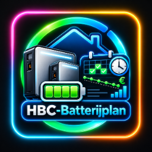
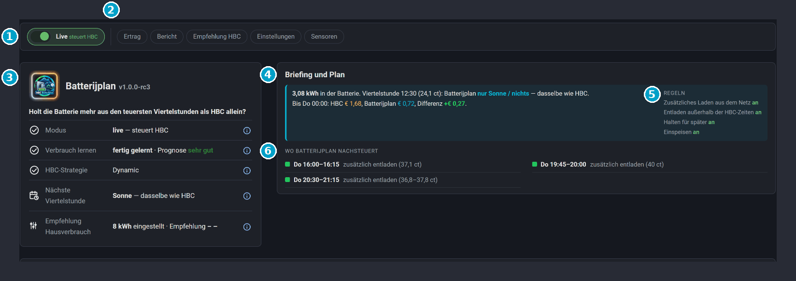

  

# Batterijplan — eine schlaue Schicht über Home Battery Control (HBC)

*English: [README.md](https://github.com/satscan1/hbc-batterijplan/blob/main/README.md) · Nederlands: [README.nl.md](https://github.com/satscan1/hbc-batterijplan/blob/main/README.nl.md)*

*Version 1.0.0-rc4 · Release Candidate*

Batterijplan sorgt dafür, dass dein Hausspeicher seine Ladung für die **teuersten** Momente des Tages aufhebt. Es arbeitet mit [Home Battery Control (HBC)](https://github.com/gitcodebob/marstek-venus-rs485-node-red) zusammen und übernimmt HBC nicht: HBC steuert weiter den Speicher, Batterijplan gibt nur pro Viertelstunde einen Hinweis.

> Batterijplan ist eine eigenständige, inoffizielle Ergänzung zu HBC. Es wird nicht von den Machern von HBC entwickelt oder gepflegt. Fragen zu Batterijplan stellst du hier, nicht bei HBC.

1. **Live**: an = Batterijplan steuert HBC. Aus = Schattenmodus: es rechnet mit, steuert aber nichts.
2. **Knöpfe**: Ertrag, Bericht, Empfehlung HBC, Einstellungen und Sensoren. Jeder Knopf öffnet ein Fenster.
3. **Statuskarte**: Modus, Verbrauch lernen, HBC-Strategie, nächste Viertelstunde und Empfehlung Hausverbrauch. Das (i) hinter jeder Zeile erklärt sie.
4. **Briefing und Plan**: was jetzt in der Batterie ist, was der Plan in der nächsten Viertelstunde tut, und der Unterschied zu HBC allein.
5. **Regeln**: die vier Regeln, jede mit eigenem Ein/Aus-Schalter.
6. **Wo Batterijplan nachsteuert**: die Blöcke, in denen der Plan etwas anderes tut als HBC.

## Was Batterijplan tut

- **Hebt Ladung für die teuersten Viertelstunden auf.** HBC (Strategie Dynamic) entlädt in jeder teuren Viertelstunde der Reihe nach, auch wenn eine Stunde später ein noch teurerer Moment kommt. Batterijplan rechnet bis zum nächsten günstigen Moment voraus und gibt die Ladung zuerst den teuersten Viertelstunden. In den anderen teuren Viertelstunden hält der Speicher seine Ladung.
- **Nutzt Überschuss schlau.** Ist mehr im Speicher, als bis zum nächsten günstigen Moment nötig ist? Dann gibt Batterijplan diesen Überschuss schon in den teuersten normalen Viertelstunden ans Haus ab, statt mit einem vollen Speicher laden zu gehen.
- **Lernt deinen Verbrauch.** Pro Stunde des Tages, in 7 Tagen, und danach gleitend mit den Jahreszeiten. Mit der Solarprognose von Solcast dazu.
- **Gibt eine Empfehlung für HBC.** Wie viel Solarstrom dein Haus selbst verbraucht (die HBC-Einstellung *Solar reserved for house*), auf Basis der letzten 7 Tage. Batterijplan ändert diese Einstellung nie selbst.
- **Zeigt, was es bringt.** Eine ehrliche Schätzung zusätzlich zu HBC allein: Beim Überschuss entladen zählt nur, was wirklich aus dem Speicher kam.
- **Startet sicher.** Zuerst im Schattenmodus (rechnet mit, steuert nichts). Erst wenn du *Live* einschaltest, steuert es HBC nach.

## Neu in 1.0.0-rc3

- **Eine echte Home-Assistant-Integration:** mit HACS installieren und in einem Formular unter *Geräte & Dienste* einrichten. Kein YAML-Paket, keine Dateien kopieren, keine Dashboard-Ressource.
- **Eingebautes Dashboard** in der Seitenleiste (`/batterijplan`), auf Niederländisch, Englisch und Deutsch.
- **Vier Regeln mit eigenem Schalter:** aus dem Netz laden, außerhalb der HBC-Zeiten entladen, halten, einspeisen. Die Schwelle ist die von HBC selbst.
- **Laden aus dem Netz in Blöcken von mindestens 30 Minuten**, damit HBC auch wirklich lädt.
- **Empfehlung für HBC eingebaut**, mit eigener Karte; der Status zeigt die Empfehlung nach 7 Tagen Messen.
- **Schattenwert nur bei ausgeschaltetem Live**, höchstens 30 Tage aufbewahrt.
- **Zahlen folgen deinem Home-Assistant-Zahlenformat** (Komma oder Punkt). Tippe auf das Logo für das Jahreszeitenbild.

Alles auf einen Blick: [CHANGELOG.md](CHANGELOG.md).

## Dokumentation

| | |
|---|---|
| [01 · Installation](docs/01-installation.de.md) | Was du brauchst, mit HACS installieren, einrichten |
| [02 · Das Dashboard](docs/02-dashboard.de.md) | Was jede Karte zeigt |
| [03 · So funktioniert es](docs/03-how-it-works.de.md) | Der Plan, Überschuss, Lernen, die Empfehlung und der Zähler in einfacher Sprache |
| [04 · Pflege und Aktualisieren](docs/04-maintenance.de.md) | Was du ab und zu tust, neue Version, Entfernen |
| [05 · Probleme lösen](docs/05-troubleshooting.de.md) | Bekannte Meldungen und was du dagegen tust |

## Release Candidate

Dies ist ein **Release Candidate** (rc): die letzte Testversion vor 1.0.0. Er läuft täglich beim Macher und bei ein paar Testern. Starte ihn zuerst im Schattenmodus, schau ein paar Tage zu und melde, was dir auffällt, über [Issues](https://github.com/satscan1/hbc-batterijplan/issues) oder auf Discord. Nenne deine HBC-Version und, bei einer Fehlermeldung, einen Screenshot.

## Lizenz

- **Code** (Integration, Karten und Dashboard): GPL-3.0-or-later.
- **Icons und Logo** (`custom_components/batterijplan/frontend/` und `brand/`): eigener Hausstil von SatScan, siehe [LICENSE-ICONS.md](LICENSE-ICONS.md).

Batterijplan ist eine eigenständige Ergänzung zu [Home Battery Control](https://github.com/gitcodebob/marstek-venus-rs485-node-red) und wird nicht von den Machern von HBC gepflegt.
