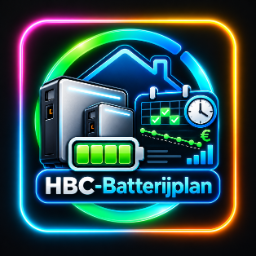
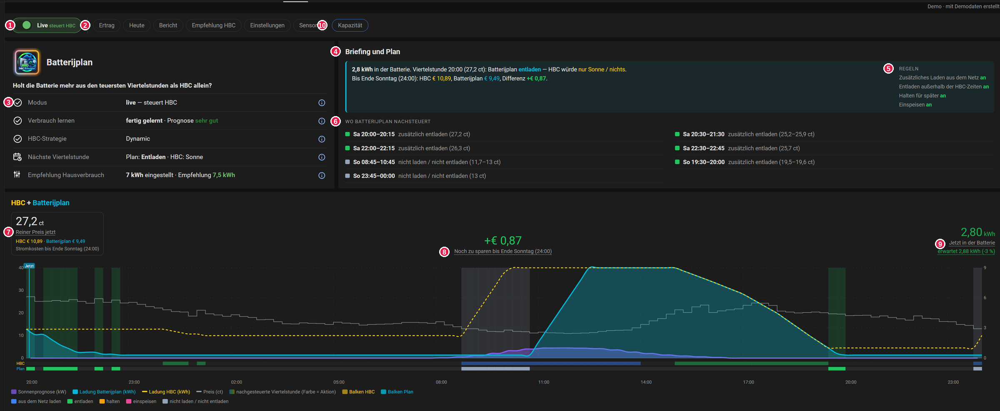

  

# Batterijplan — eine schlaue Schicht über Home Battery Control (HBC)

*English: [README.md](https://github.com/satscan1/hbc-batterijplan/blob/main/README.md) · Nederlands: [README.nl.md](https://github.com/satscan1/hbc-batterijplan/blob/main/README.nl.md)*

*Version 2.0.0*

Batterijplan sorgt dafür, dass dein Hausspeicher seine Ladung für die **teuersten** Momente des Tages aufhebt. Es arbeitet mit [Home Battery Control (HBC)](https://github.com/gitcodebob/marstek-venus-rs485-node-red) zusammen und übernimmt HBC nicht: HBC steuert weiter den Speicher, Batterijplan gibt nur pro Viertelstunde einen Hinweis.

Es ist für Haushalte in den Niederlanden, Deutschland und Belgien (Flandern) mit einem dynamischen oder festen Stromvertrag gedacht.

> Batterijplan ist eine eigenständige, inoffizielle Ergänzung zu HBC. Es wird nicht von den Machern von HBC entwickelt oder gepflegt. Fragen zu Batterijplan stellst du hier, nicht bei HBC.

Die Beträge im Bild sind Beispielzahlen.

1. **Live**: an = Batterijplan steuert HBC. Aus = Schattenmodus: es rechnet mit, steuert aber nichts.
2. **Knöpfe**: Ertrag, Bericht, Empfehlung HBC, Einstellungen und Sensoren. Jeder Knopf öffnet ein Fenster. Der orange Punkt auf **Empfehlung HBC** bedeutet, dass *cheapest hrs*, *expensive hrs* oder *Solar reserved for house* von der Empfehlung abweicht (um mindestens 1 Stunde oder 1 kWh); im Fenster steht auch der Schalter *HBC-Einstellungen automatisch anpassen*.
3. **Statuskarte**: Modus, Verbrauch lernen, HBC-Strategie, nächste Viertelstunde und Empfehlung Hausverbrauch. Das (i) hinter jeder Zeile erklärt sie.
4. **Briefing und Plan**: was jetzt in der Batterie ist, was der Plan in der nächsten Viertelstunde tut, und der Kostenunterschied zu HBC allein bis Mitternacht.
5. **Regeln**: die vier Regeln (*Zusätzliches Laden aus dem Netz*, *Entladen außerhalb der HBC-Zeiten*, *Halten für später*, *Einspeisen*), jede mit eigenem Ein/Aus-Schalter.
6. **Wo Batterijplan nachsteuert**: die Blöcke, in denen der Plan etwas anderes tut als HBC, mit einer Farbe pro Aktion und dem Preis.
7. **Reiner Preis jetzt und die Stromkosten bis Mitternacht**: HBC neben Batterijplan.
8. **Erwartete Ersparnis** gegenüber HBC allein.
9. **Batterie**: wie viele kWh jetzt in der Batterie sind.

## Was Batterijplan tut

- **Hebt Ladung für die teuersten Viertelstunden auf.** HBC (Strategie Dynamic) entlädt in jeder teuren Viertelstunde der Reihe nach, auch wenn eine Stunde später ein noch teurerer Moment kommt. Batterijplan rechnet bis zum nächsten günstigen Moment voraus und gibt die Ladung zuerst den teuersten Viertelstunden. In den anderen teuren Viertelstunden hält der Speicher seine Ladung.
- **Nutzt Überschuss schlau.** Ist mehr im Speicher, als bis zum nächsten günstigen Moment nötig ist? Dann gibt Batterijplan diesen Überschuss schon in den teuersten normalen Viertelstunden ans Haus ab, statt mit einem vollen Speicher laden zu gehen.
- **Lernt deinen Verbrauch.** Pro Stunde des Tages, in 7 Tagen, und danach gleitend mit den Jahreszeiten. Mit der Solarprognose von Solcast dazu.
- **Gibt eine Empfehlung für HBC.** Wie viel Solarstrom dein Haus selbst verbraucht (die HBC-Einstellung *Solar reserved for house*), auf Basis der letzten 7 Tage. Es gibt auch Empfehlungen für *cheapest hrs* und *expensive hrs*. Nur wenn du den Schalter *HBC-Einstellungen automatisch anpassen* einschaltest (standardmäßig aus), ändert es diese drei HBC-Einstellungen selbst; deine eigenen Werte kommen beim Ausschalten zurück. An den Flows oder am Code von HBC ändert es nie etwas.
- **Zeigt, was es bringt.** Eine ehrliche Schätzung zusätzlich zu HBC allein: Beim Überschuss entladen zählt nur, was wirklich aus dem Speicher kam.
- **Startet sicher.** Zuerst im Schattenmodus (rechnet mit, steuert nichts). Erst wenn du *Live* einschaltest, steuert es HBC nach.

## Neu in 2.0.0

Alle Änderungen seit 1.1.0:

- **Vertrag wählen:** Festpreis mit Einheitstarif, Festpreis mit Tag/Nacht-Tarif oder dynamisch. Bei einem festen Vertrag bleibt HBC auf *Self-consumption*; beim Tag/Nacht-Tarif lädt der Speicher nachts nur aus dem Netz, wenn es sich lohnt.
- **Flandern (Kapazitätstarif):** ein eigener Schalter, mit jedem Vertrag. Spitze pro Viertelstunde, eine Zielgrenze, die der Monatsspitze folgt, und die Monatsspitze mit und ohne Speicher mit der Ersparnis.
- **Laden in jeder günstigen Viertelstunde:** Batterijplan erkennt günstige Viertelstunden selbst, auch außerhalb der maximalen Zahl günstiger Stunden von HBC *(neuer Schalter, standardmäßig aus, dynamischer Vertrag)*.
- **Sonnenmarge:** je weiter voraus, desto vorsichtiger geht Batterijplan mit der Solarprognose um.
- **Dunkle Tage:** kommen Tage mit kaum Sonne, hält der Plan Ladung und lädt nur in günstigen Viertelstunden nach.
- **Lernende Reserve:** beginnt bei 20 % und sinkt auf 3 %, je besser Verbrauch und Sonne vorhergesagt werden. Deine eigene Marge bleibt die Untergrenze.
- **Verbrauch pro Wochentag** als Selbsttest: nur genutzt, wenn er wirklich besser vorhersagt.
- **Verkaufsreserve automatisch:** Batterijplan setzt jede Viertelstunde das *Keep energy in reserve* von HBC auf das, was dein Haus bis zum nächsten günstigen Moment braucht, damit HBC nie verkauft, was du später selbst brauchst *(neuer Schalter, standardmäßig aus)*.
- **Bildschirme:** Bericht und Heute funktionieren mit jedem Vertrag; die Einstellungen haben neue Reiter *Vertrag* und *Flandern*; klarere Erklärungen.
- **Land aus Home Assistant**; Solarempfehlung in ganzen kWh; klarere Namen `laaddoel_kwh` und `zon_voor_huis` für eigene Karten und HBC+.
- **Behoben:** kein Hin-und-her-Wechseln mehr zwischen Charge und Dynamic, kein „+610 %", keine Importgrenze von 25 kW nach einem Neustart, kein leeres Ladediagramm nach einem Neustart.

Alles auf einen Blick: [Alle Änderungen in 2.0.0](docs/AENDERUNGEN_v2.0.0.de.md) · [CHANGELOG.md](CHANGELOG.md).

## Installation

1. Öffne HACS, suche nach **HBC Batterijplan** und wähle **Herunterladen**.
2. Du findest sie nicht? Füge sie als benutzerdefiniertes Repository hinzu: HACS → Menü (⋮) → **Benutzerdefinierte Repositories** → `https://github.com/satscan1/hbc-batterijplan`, Kategorie **Integration**. Suche sie danach und lade sie herunter.
3. Starte Home Assistant neu, dann *Einstellungen → Geräte & Dienste → Integration hinzufügen → Batterijplan*.

Details: [01 · Installation](docs/01-installation.de.md).

## Dokumentation

| | |
|---|---|
| [01 · Installation](docs/01-installation.de.md) | Was du brauchst, mit HACS installieren, einrichten |
| [02 · Das Dashboard](docs/02-dashboard.de.md) | Was jede Karte zeigt |
| [03 · So funktioniert es](docs/03-how-it-works.de.md) | Der Plan, Überschuss, Lernen, die Empfehlung und der Zähler in einfacher Sprache |
| [04 · Pflege und Aktualisieren](docs/04-maintenance.de.md) | Was du ab und zu tust, neue Version, Entfernen |
| [05 · Probleme lösen](docs/05-troubleshooting.de.md) | Bekannte Meldungen und was du dagegen tust |
| [07 · Verträge, Nebenzeiten und Flandern](docs/07-contracts-and-flanders.de.md) | Welcher Vertrag, Fest- und Zweitarif, der flämische Kapazitätstarif |
| [08 · Klüger rechnen](docs/08-calculation.de.md) | Sonnenmarge, dunkle Tage, lernende Reserve, Verbrauch pro Wochentag, Laden in jeder günstigen Viertelstunde, Verkaufsreserve (2.0.0) |
| [Alle Änderungen in 2.0.0](docs/AENDERUNGEN_v2.0.0.de.md) | Alles, was seit 1.1.0 neu, verbessert, behoben und entfernt ist |

## Status

2.0.0 ist die neueste vollständige Version. Starte sie zuerst im Schattenmodus, schau ein paar Tage zu und melde, was dir auffällt, über [Issues](https://github.com/satscan1/hbc-batterijplan/issues). Nenne deine HBC-Version und, bei einer Fehlermeldung, einen Screenshot.

## Lizenz

- **Code** (Integration, Karten und Dashboard): GPL-3.0-or-later.
- **Icons und Logo** (`custom_components/batterijplan/frontend/` und `brand/`): eigener Hausstil von SatScan, siehe [LICENSE-ICONS.md](LICENSE-ICONS.md).

Batterijplan ist eine eigenständige Ergänzung zu [Home Battery Control](https://github.com/gitcodebob/marstek-venus-rs485-node-red) und wird nicht von den Machern von HBC gepflegt.
