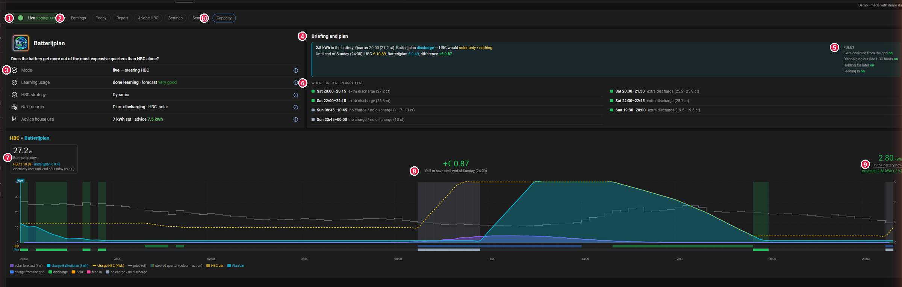

  

# Batterijplan — a smart layer on top of Home Battery Control (HBC)

*Nederlands: [README.nl.md](https://github.com/satscan1/hbc-batterijplan/blob/main/README.nl.md) · Deutsch: [README.de.md](https://github.com/satscan1/hbc-batterijplan/blob/main/README.de.md)*

*Version 2.0.0*

Batterijplan makes your home battery save its charge for the **most expensive** moments of the day. It works together with [Home Battery Control (HBC)](https://github.com/gitcodebob/marstek-venus-rs485-node-red) and does not take HBC over: HBC keeps controlling the battery, Batterijplan only gives it a hint for each quarter of an hour.

It is made for households in the Netherlands, Germany and Belgium (Flanders) with a dynamic or a fixed energy contract.

> Batterijplan is a separate, unofficial add-on to HBC. It is not made or maintained by the makers of HBC. Ask your questions about Batterijplan here, not at HBC.

The amounts in the picture are example figures.

1. **Live**: on = Batterijplan steers HBC. Off = shadow mode: it calculates along, but steers nothing.
2. **Buttons**: Earnings, Report, Advice HBC, Settings and Sensors. Each button opens a window. The orange dot on **Advice HBC** means that *cheapest hrs*, *expensive hrs* or *Solar reserved for house* differs from the advice (by at least 1 hour or 1 kWh); the window also has the switch *Auto-adjust HBC settings*.
3. **Status card**: mode, learning usage, HBC strategy, next quarter and advice house use. The (i) behind each line explains it.
4. **Briefing and plan**: what is in the battery now, what the plan does in the next quarter, and the difference in cost with HBC alone until midnight.
5. **Rules**: the four rules (*Extra charging from the grid*, *Discharging outside HBC hours*, *Holding for later*, *Feeding in*), each with its own on/off switch.
6. **Where Batterijplan steers**: the blocks in which the plan does something different from HBC, with a colour for each action and the price.
7. **Bare price now and the electricity cost until midnight**: HBC next to Batterijplan.
8. **Expected saving** compared with HBC alone.
9. **Battery**: how many kWh are in the battery now.

## What Batterijplan does

- **Saves charge for the most expensive quarters.** HBC (strategy Dynamic) discharges in every expensive quarter in turn, even when an even more expensive moment comes an hour later. Batterijplan looks ahead to the next cheap moment and gives the charge to the most expensive quarters first. In the other expensive quarters the battery holds on to its charge.
- **Uses surplus wisely.** Is there more in the battery than you need until the next cheap moment? Then Batterijplan already delivers that surplus to the house in the most expensive regular quarters, instead of starting to charge with a full battery.
- **Learns your usage.** Per hour of the day, in 7 days, and after that it keeps moving along with the seasons. With the solar forecast from Solcast added in.
- **Gives advice for HBC.** How much solar energy your house uses itself (the HBC setting *Solar reserved for house*), based on the last 7 days. It also advises on *cheapest hrs* and *expensive hrs*. Only when you turn on the switch *Auto-adjust HBC settings* (off by default) does it set these three HBC settings itself; your own values come back when you switch it off. It never touches HBC's flows or code.
- **Shows what it earns.** An honest estimate on top of HBC alone: for surplus discharging, only what really came out of the battery counts.
- **Starts safely.** First in shadow mode (it calculates along, but steers nothing). Only when you turn on *Live* does it steer HBC.

## New in 2.0.0

All changes since 1.1.0:

- **Choose your contract:** fixed single rate, fixed day/night rate or dynamic. With a fixed contract HBC stays on *Self-consumption*; on a day/night rate the battery only charges from the grid at night when that pays.
- **Flanders (capacity tariff):** its own switch, with every contract. Peak per quarter, a target limit that follows the monthly peak, and the monthly peak with and without battery with what it saves.
- **Charge in any cheap quarter:** Batterijplan recognises cheap quarters itself, also outside HBC's maximum number of cheap hours *(new switch, off by default, dynamic contract)*.
- **Solar margin:** the further ahead, the more careful Batterijplan is with the solar forecast.
- **Dark days:** when days with hardly any sun are coming, the plan keeps charge and only tops up in cheap quarters.
- **Reserve that learns:** starts at 20 % and drops to 3 % as consumption and sun are predicted better. Your own margin stays the floor.
- **Use per weekday** as a self-test: only used when it really predicts better.
- **Sell reserve automatic:** Batterijplan sets HBC's *Keep energy in reserve* every quarter to what your house needs until the next cheap moment, so HBC never sells what you need later *(new switch, off by default)*.
- **Screens:** Report and Today work with every contract; Settings has new tabs *Contract* and *Flanders*; clearer help texts.
- **Country from Home Assistant**; solar advice in whole kWh; clearer names `laaddoel_kwh` and `zon_voor_huis` for your own cards and HBC+.
- **Fixed:** no more switching back and forth between Charge and Dynamic, no "+610 %", no 25 kW import limit after a restart, no empty charge chart after a restart.

Everything at a glance: [All changes in 2.0.0](docs/CHANGES_v2.0.0.md) · [CHANGELOG.md](CHANGELOG.md).

## Installation

1. Open HACS, search for **HBC Batterijplan** and choose **Download**.
2. Can't find it? Add it as a custom repository: HACS → menu (⋮) → **Custom repositories** → `https://github.com/satscan1/hbc-batterijplan`, category **Integration**. Then search for it and download it.
3. Restart Home Assistant, then *Settings → Devices & services → Add integration → Batterijplan*.

Details: [01 · Installation](docs/01-installation.md).

## Documentation

| | |
|---|---|
| [01 · Installation](docs/01-installation.md) | What you need, installing with HACS, setting up |
| [02 · The dashboard](docs/02-dashboard.md) | What each card shows |
| [03 · How it works](docs/03-how-it-works.md) | The plan, surplus, learning, the advice and the counter in plain language |
| [04 · Maintenance and updating](docs/04-maintenance.md) | What you do now and then, a new version, removing it |
| [05 · Troubleshooting](docs/05-troubleshooting.md) | Known messages and what to do about them |
| [07 · Contracts, off-peak hours and Flanders](docs/07-contracts-and-flanders.md) | Which contract to choose, Fixed and day/night rates, the Flemish capacity tariff |
| [08 · Smarter calculation](docs/08-calculation.md) | Solar margin, dark days, the learning reserve, use per weekday, charging in any cheap quarter, sell reserve (2.0.0) |
| [All changes in 2.0.0](docs/CHANGES_v2.0.0.md) | Everything new, improved, fixed and removed since 1.1.0 |

## Status

2.0.0 is the latest full release. Start in shadow mode first, watch it for a few days and report what you notice via [Issues](https://github.com/satscan1/hbc-batterijplan/issues). Mention your HBC version and, for an error message, add a screenshot.

## License

- **Code** (integration, cards and dashboard): GPL-3.0-or-later.
- **Icons and logo** (`custom_components/batterijplan/frontend/` and `brand/`): SatScan's own house style, see [LICENSE-ICONS.md](LICENSE-ICONS.md).

Batterijplan is a separate add-on to [Home Battery Control](https://github.com/gitcodebob/marstek-venus-rs485-node-red) and is not maintained by the makers of HBC.
