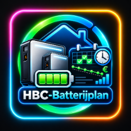
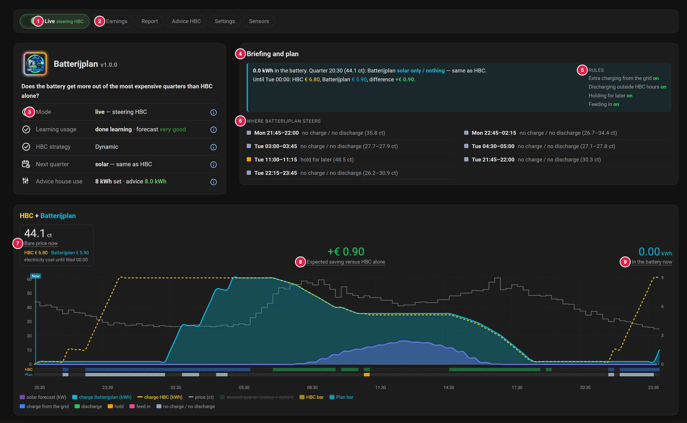

  

# Batterijplan — a smart layer on top of Home Battery Control (HBC)

*Nederlands: [README.nl.md](https://github.com/satscan1/hbc-batterijplan/blob/main/README.nl.md) · Deutsch: [README.de.md](https://github.com/satscan1/hbc-batterijplan/blob/main/README.de.md)*

*Version 1.0.1*

Batterijplan makes your home battery save its charge for the **most expensive** moments of the day. It works together with [Home Battery Control (HBC)](https://github.com/gitcodebob/marstek-venus-rs485-node-red) and does not take HBC over: HBC keeps controlling the battery, Batterijplan only gives it a hint for each quarter of an hour.

It is made for households in the Netherlands, Germany and Belgium (Flanders) with a dynamic energy contract.

> Batterijplan is a separate, unofficial add-on to HBC. It is not made or maintained by the makers of HBC. Ask your questions about Batterijplan here, not at HBC.

The amounts in the picture are example figures.

1. **Live**: on = Batterijplan steers HBC. Off = shadow mode: it calculates along, but steers nothing.
2. **Buttons**: Earnings, Report, Advice HBC, Settings and Sensors. Each button opens a window. The orange dot on **Advice HBC** means that *cheapest hrs*, *expensive hrs* or *Solar reserved for house* differs from the advice (by at least 1 hour or 0.5 kWh); the window also has the switch *Auto-adjust HBC settings*.
3. **Status card**: mode, learning usage, HBC strategy, next quarter and advice house use. The (i) behind each line explains it.
4. **Briefing and plan**: what is in the battery now, what the plan does in the next quarter, and the difference in cost with HBC alone until midnight.
5. **Rules**: the four rules (*Extra charging from the grid*, *Discharging outside HBC hours*, *Holding for later*, *Feeding in*), each with its own on/off switch.
6. **Where Batterijplan steers**: the blocks in which the plan does something different from HBC, with a colour for each action and the price.
7. **Bare price now and the electricity cost until midnight**: HBC next to Batterijplan.
8. **Expected saving** compared with HBC alone.
9. **Battery**: how many kWh are in the battery now.

## What Batterijplan does

- **Saves charge for the most expensive quarters.** HBC (strategy Dynamic) discharges in every expensive quarter in turn, even when an even more expensive moment comes an hour later. Batterijplan looks ahead to the next cheap moment and gives the charge to the most expensive quarters first. In the other expensive quarters the battery holds on to its charge.
- **Uses surplus wisely.** Is there more in the battery than you need until the next cheap moment? Then Batterijplan already delivers that surplus to the house in the most expensive regular quarters, instead of starting to charge with a full battery.
- **Learns your usage.** Per hour of the day, in 7 days, and after that it keeps moving along with the seasons. With the solar forecast from Solcast added in.
- **Gives advice for HBC.** How much solar energy your house uses itself (the HBC setting *Solar reserved for house*), based on the last 7 days. It also advises on *cheapest hrs* and *expensive hrs*. Only when you turn on the switch *Auto-adjust HBC settings* (off by default) does it set these three HBC settings itself; your own values come back when you switch it off. It never touches HBC's flows or code.
- **Shows what it earns.** An honest estimate on top of HBC alone: for surplus discharging, only what really came out of the battery counts.
- **Starts safely.** First in shadow mode (it calculates along, but steers nothing). Only when you turn on *Live* does it steer HBC.

## New in 1.0.0

- **Country setting:** Germany (fixed feed-in tariff) and Belgium/Flanders (capacity tariff, uses the HBC import limit), next to the Netherlands.
- **Calmer plan at nearly equal prices:** a switching cost of 2 ct between holding and selling back, so the plan no longer flips for a fraction of a cent.
- **Readable in light mode:** darker colours for the plan card and legend in Home Assistant's light theme; the dark theme is unchanged.
- **Time zone from Home Assistant:** read without a blocking call (review feedback).
- **Solar forecast for HBC:** the new sensor `sensor.batterijplan_zon_voor_hbc` lets HBC stop grid charging at the level the plan wants. Without a plan, or with Live off, it passes the real forecast on 1:1.
- **Solcast names:** found automatically in English, Dutch and German, or fill in your own sensors in the *Sensors* window.
- **Auto-adjust HBC settings:** a switch (off by default) that sets *cheapest hrs*, *expensive hrs* and *Solar reserved for house* to the advice. Your own values come back when you turn it off. The card *Advice for HBC* shows all three settings.
- **Live charge level:** *In the battery now* follows the battery as it changes, in steps of 0.1 kWh.
- **Lighter on the database:** the large plan details are no longer written to the recorder.
- **Chart tooltip:** hover or tap to see time, price, solar, charge and actions per quarter.
- **A real Home Assistant integration:** install it with HACS and set it up in a form under *Devices & services*. No YAML package, no files to copy, no dashboard resource.
- **Built-in dashboard** in the sidebar (`/batterijplan`), in Dutch, English and German.
- **Four rules, each with its own switch:** charge from the grid, discharge outside HBC hours, hold, feed in. The threshold is HBC's own.
- **Grid charging in blocks of at least 30 minutes**, so HBC really starts charging.
- **Advice for HBC built in**, with its own card; the status shows the advice after 7 days of measuring.
- **Shadow value only while Live is off**, kept for at most 30 days.
- **Numbers follow your Home Assistant number format** (comma or point). Tap the logo for the season picture.

Everything at a glance: [CHANGELOG.md](CHANGELOG.md).

## Installation

1. Open HACS, search for **HBC Batterijplan** and choose **Download** (once the integration is in the HACS default list).
2. Not listed yet, or you do not see it? Add it as a custom repository: HACS → menu (⋮) → **Custom repositories** → `https://github.com/satscan1/hbc-batterijplan`, category **Integration**. Then search for it and download it.
3. Restart Home Assistant, then *Settings → Devices & services → Add integration → Batterijplan*.

Details: [01 · Installation](docs/01-installation.md).

## Documentation

| | |
|---|---|
| [01 · Installation](docs/01-installation.md) | What you need, installing with HACS, setting up |
| [02 · The dashboard](docs/02-dashboard.md) | What each card shows |
| [03 · How it works](docs/03-how-it-works.md) | The plan, surplus, learning, the advice and the counter in plain language |
| [04 · Maintenance and updating](docs/04-maintenance.md) | What you do now and then, a new version, removing it |
| [05 · Troubleshooting](docs/05-troubleshooting.md) | Known messages and what to do about them |

## Status

1.0.0 is the first full release. Start in shadow mode first, watch it for a few days and report what you notice via [Issues](https://github.com/satscan1/hbc-batterijplan/issues). Mention your HBC version and, for an error message, add a screenshot.

## License

- **Code** (integration, cards and dashboard): GPL-3.0-or-later.
- **Icons and logo** (`custom_components/batterijplan/frontend/` and `brand/`): SatScan's own house style, see [LICENSE-ICONS.md](LICENSE-ICONS.md).

Batterijplan is a separate add-on to [Home Battery Control](https://github.com/gitcodebob/marstek-venus-rs485-node-red) and is not maintained by the makers of HBC.
