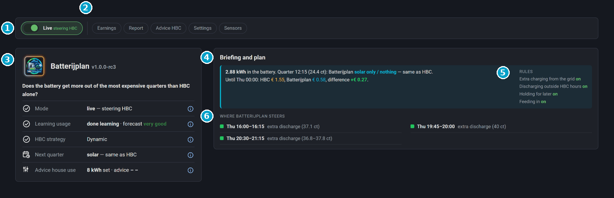

  

# Batterijplan — a smart layer on top of Home Battery Control (HBC)

*Nederlands: [README.nl.md](https://github.com/satscan1/hbc-batterijplan/blob/main/README.nl.md) · Deutsch: [README.de.md](https://github.com/satscan1/hbc-batterijplan/blob/main/README.de.md)*

*Version 1.0.0-rc3 · release candidate*

Batterijplan makes your home battery save its charge for the **most expensive** moments of the day. It works together with [Home Battery Control (HBC)](https://github.com/gitcodebob/marstek-venus-rs485-node-red) and does not take HBC over: HBC keeps controlling the battery, Batterijplan only gives it a hint for each quarter of an hour.

> Batterijplan is a separate, unofficial add-on to HBC. It is not made or maintained by the makers of HBC. Ask your questions about Batterijplan here, not at HBC.

## What Batterijplan does

- **Saves charge for the most expensive quarters.** HBC (strategy Dynamic) discharges in every expensive quarter in turn, even when an even more expensive moment comes an hour later. Batterijplan looks ahead to the next cheap moment and gives the charge to the most expensive quarters first. In the other expensive quarters the battery holds on to its charge.
- **Uses surplus wisely.** Is there more in the battery than you need until the next cheap moment? Then Batterijplan already delivers that surplus to the house in the most expensive regular quarters, instead of starting to charge with a full battery.
- **Learns your usage.** Per hour of the day, in 7 days, and after that it keeps moving along with the seasons. With the solar forecast from Solcast added in.
- **Gives advice for HBC.** How much solar energy your house uses itself (the HBC setting *Solar reserved for house*), based on the last 7 days. Batterijplan never changes that setting itself.
- **Shows what it earns.** An honest estimate on top of HBC alone: for surplus discharging, only what really came out of the battery counts.
- **Starts safely.** First in shadow mode (it calculates along, but steers nothing). Only when you turn on *Live* does it steer HBC.

## New in 1.0.0-rc3

- **A real Home Assistant integration:** install it with HACS and set it up in a form under *Devices & services*. No YAML package, no files to copy, no dashboard resource.
- **Built-in dashboard** in the sidebar (`/batterijplan`), in Dutch, English and German.
- **Four rules, each with its own switch:** charge from the grid, discharge outside HBC hours, hold, feed in. The threshold is HBC's own.
- **Grid charging in blocks of at least 30 minutes**, so HBC really starts charging.
- **Advice for HBC built in**, with its own card; the status shows the advice after 7 days of measuring.
- **Shadow value only while Live is off**, kept for at most 30 days.
- **Numbers follow your Home Assistant number format** (comma or point). Tap the logo for the season picture.

Everything at a glance: [CHANGELOG.md](CHANGELOG.md).

## Documentation

| | |
|---|---|
| [01 · Installation](docs/01-installation.md) | What you need, installing with HACS, setting up |
| [02 · The dashboard](docs/02-dashboard.md) | What each card shows |
| [03 · How it works](docs/03-how-it-works.md) | The plan, surplus, learning, the advice and the counter in plain language |
| [04 · Maintenance and updating](docs/04-maintenance.md) | What you do now and then, a new version, removing it |
| [05 · Troubleshooting](docs/05-troubleshooting.md) | Known messages and what to do about them |

## Release candidate

This is a **release candidate** (rc): the last test version before 1.0.0. It runs every day at the maker's home and with a few testers. Start in shadow mode first, watch it for a few days and report what you notice via [Issues](https://github.com/satscan1/hbc-batterijplan/issues) or on Discord. Mention your HBC version and, for an error message, add a screenshot.

## License

- **Code** (integration, cards and dashboard): GPL-3.0-or-later.
- **Icons and logo** (`custom_components/batterijplan/frontend/` and `brand/`): SatScan's own house style, see [LICENSE-ICONS.md](LICENSE-ICONS.md).

Batterijplan is a separate add-on to [Home Battery Control](https://github.com/gitcodebob/marstek-venus-rs485-node-red) and is not maintained by the makers of HBC.
