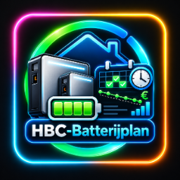
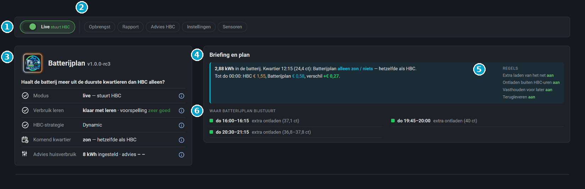

  

# Batterijplan — slimme laag bovenop Home Battery Control (HBC)

*English: [README.md](https://github.com/satscan1/hbc-batterijplan/blob/main/README.md) · Deutsch: [README.de.md](https://github.com/satscan1/hbc-batterijplan/blob/main/README.de.md)*

*Versie 1.0.0*

Batterijplan zorgt dat je thuisbatterij zijn lading bewaart voor de **duurste** momenten van de dag. Het werkt samen met [Home Battery Control (HBC)](https://github.com/gitcodebob/marstek-venus-rs485-node-red) en neemt HBC niet over: HBC blijft de batterij aansturen, Batterijplan geeft alleen per kwartier een aanwijzing.

Het is bedoeld voor huishoudens in Nederland, Duitsland en België (Vlaanderen) met een dynamisch energiecontract.

> Batterijplan is een losse, onofficiële aanvulling op HBC. Het wordt niet door de makers van HBC gemaakt of onderhouden. Vragen over Batterijplan stel je hier, niet bij HBC.

1. **Live**: aan = Batterijplan stuurt HBC. Uit = schaduwmodus: het rekent mee, maar stuurt niets.
2. **Knoppen**: Opbrengst, Rapport, Advies HBC, Instellingen en Sensoren. Elke knop opent een venster.
3. **Statuskaart**: modus, verbruik leren, HBC-strategie, komend kwartier en advies huisverbruik. De (i) achter elke regel legt hem uit.
4. **Briefing en plan**: wat er nu in de batterij zit, wat het plan het komende kwartier doet en het verschil met HBC alleen.
5. **Regels**: de vier regels, elk met een eigen aan/uit-schakelaar.
6. **Waar Batterijplan bijstuurt**: de blokken waarin het plan iets anders doet dan HBC.

## Wat Batterijplan doet

- **Bewaart lading voor de duurste kwartieren.** HBC (strategie Dynamic) ontlaadt in elk duur kwartier op volgorde, ook als er een uur later een nog duurder moment komt. Batterijplan rekent vooruit tot het volgende goedkope moment en geeft de lading eerst aan de duurste kwartieren. In de andere dure kwartieren houdt de batterij zijn lading vast.
- **Gebruikt overschot slim.** Zit er meer in de batterij dan nodig is tot het volgende goedkope moment? Dan levert Batterijplan dat overschot al aan het huis in de duurste gewone kwartieren, in plaats van met een volle batterij te gaan laden.
- **Leert je verbruik.** Per uur van de dag, in 7 dagen, en daarna glijdend mee met de seizoenen. Met de zonverwachting van Solcast erbij.
- **Geeft advies voor HBC.** Hoeveel zonne-energie je huis zelf gebruikt (de HBC-instelling *Solar reserved for house*), op basis van de laatste 7 dagen. Sinds rc6 adviseert het ook over *cheapest hrs* en *expensive hrs*. Alleen als je de schakelaar *HBC-instellingen automatisch* aanzet (standaard uit) past het deze drie HBC-instellingen zelf aan; je eigen waarden komen terug als je hem uitzet. Aan de flows of code van HBC komt het nooit.
- **Laat zien wat het oplevert.** Een eerlijke schatting bovenop HBC alleen: bij overschot ontladen telt alleen wat er echt uit de batterij ging.
- **Begint veilig.** Eerst in schaduwmodus (rekent mee, stuurt niets). Pas als jij *Live* aanzet, stuurt het HBC bij.

## Nieuw in 1.0.0

- **Landinstelling:** Duitsland (vaste terugleververgoeding) en België/Vlaanderen (capaciteitstarief, gebruikt de importgrens van HBC), naast Nederland.
- **Rustiger plan bij bijna gelijke prijzen:** omschakelkosten van 2 ct tussen vasthouden en terugleveren, zodat het plan niet meer omslaat voor een fractie van een cent.
- **Leesbaar in lichtmodus:** donkerdere kleuren voor de plankaart en de legenda in het lichte thema van Home Assistant; het donkere thema blijft ongewijzigd.
- **Tijdzone uit Home Assistant:** gelezen zonder blokkerende aanroep (review-feedback).
- **Zonvoorspelling voor HBC:** de nieuwe sensor `sensor.batterijplan_zon_voor_hbc` laat HBC stoppen met laden van het net op het niveau dat het plan wil. Zonder plan, of met Live uit, geeft hij de echte voorspelling 1 op 1 door.
- **Solcast-namen:** automatisch gevonden in Engels, Nederlands en Duits, of vul je eigen sensoren in bij het venster *Sensoren*.
- **HBC-instellingen automatisch:** een schakelaar (standaard uit) die *cheapest hrs*, *expensive hrs* en *Solar reserved for house* op het advies zet. Je eigen waarden komen terug als je hem uitzet. De kaart *Advies HBC* toont alle drie de instellingen.
- **Live lading:** *In de batterij nu* volgt de batterij zodra die verandert, in stappen van 0,1 kWh.
- **Lichter voor de database:** de grote plandetails worden niet meer in de recorder geschreven.
- **Tooltip in de grafiek:** hover of tik voor tijd, prijs, zon, lading en acties per kwartier.
- **Echte Home Assistant-integratie:** installeren met HACS en instellen in een formulier onder *Apparaten & diensten*. Geen YAML-pakket, geen bestanden kopiëren, geen dashboardbron.
- **Ingebouwd dashboard** in de zijbalk (`/batterijplan`), in het Nederlands, Engels en Duits.
- **Vier regels met een eigen schakelaar:** laden van het net, ontladen buiten HBC-uren, vasthouden, terugleveren. De drempel is die van HBC zelf.
- **Laden van het net in blokken van minstens 30 minuten**, zodat HBC ook echt gaat laden.
- **Advies voor HBC ingebouwd**, met eigen kaart; de status toont het advies na 7 dagen meten.
- **Schaduwwaarde alleen als Live uit staat**, hooguit 30 dagen bewaard.
- **Getallen volgen je Home Assistant-getalnotatie** (komma of punt). Tik op het logo voor de seizoensplaat.

Alles op een rij: [CHANGELOG.md](CHANGELOG.md).

## Installatie

1. Open HACS, zoek **HBC Batterijplan** en kies **Downloaden** (zodra de integratie in de standaardlijst van HACS staat).
2. Staat hij er nog niet, of zie je hem niet? Voeg hem dan toe als aangepaste repository: HACS → menu (⋮) → **Aangepaste repositories** → `https://github.com/satscan1/hbc-batterijplan`, categorie **Integratie**. Zoek hem daarna op en download hem.
3. Herstart Home Assistant, ga dan naar *Instellingen → Apparaten & diensten → Integratie toevoegen → Batterijplan*.

Details: [01 · Installatie](docs/01-installation.nl.md).

## Documentatie

| | |
|---|---|
| [01 · Installatie](docs/01-installation.nl.md) | Wat je nodig hebt, installeren met HACS, instellen |
| [02 · Het dashboard](docs/02-dashboard.nl.md) | Wat elke kaart laat zien |
| [03 · Hoe het werkt](docs/03-how-it-works.nl.md) | Het plan, overschot, leren, het advies en de teller in gewone taal |
| [04 · Onderhoud en bijwerken](docs/04-maintenance.nl.md) | Wat je af en toe doet, nieuwe versie, verwijderen |
| [05 · Problemen oplossen](docs/05-troubleshooting.nl.md) | Bekende meldingen en wat je eraan doet |

## Status

1.0.0 is de eerste volledige release. Zet hem eerst in schaduwmodus, kijk een paar dagen mee en meld wat je opvalt via [Issues](https://github.com/satscan1/hbc-batterijplan/issues). Vermeld je HBC-versie en, bij een foutmelding, een schermafdruk.

## Licentie

- **Code** (integratie, kaarten en dashboard): GPL-3.0-or-later.
- **Iconen en logo** (`custom_components/batterijplan/frontend/` en `brand/`): eigen huisstijl van SatScan, zie [LICENSE-ICONS.md](LICENSE-ICONS.md).

Batterijplan is een losse aanvulling op [Home Battery Control](https://github.com/gitcodebob/marstek-venus-rs485-node-red) en wordt niet door de makers van HBC onderhouden.
