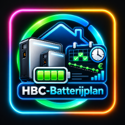
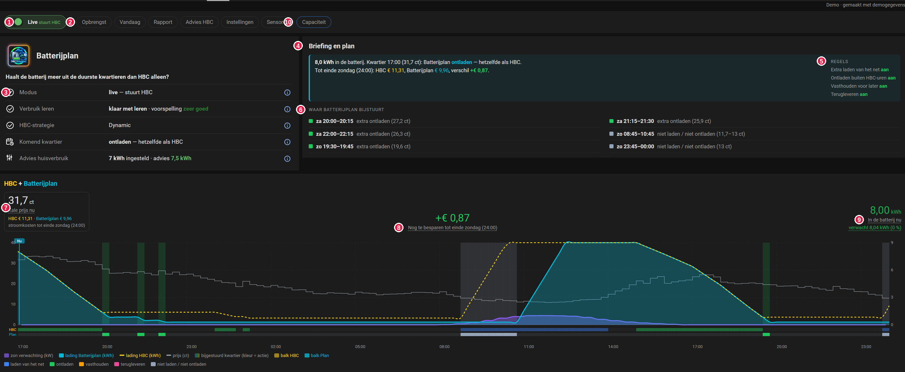

  

# Batterijplan — slimme laag bovenop Home Battery Control (HBC)

*English: [README.md](https://github.com/satscan1/hbc-batterijplan/blob/main/README.md) · Deutsch: [README.de.md](https://github.com/satscan1/hbc-batterijplan/blob/main/README.de.md)*

*Versie 2.0.0*

Batterijplan zorgt dat je thuisbatterij zijn lading bewaart voor de **duurste** momenten van de dag. Het werkt samen met [Home Battery Control (HBC)](https://github.com/gitcodebob/marstek-venus-rs485-node-red) en neemt HBC niet over: HBC blijft de batterij aansturen, Batterijplan geeft alleen per kwartier een aanwijzing.

Het is bedoeld voor huishoudens in Nederland, Duitsland en België (Vlaanderen) met een dynamisch of een vast energiecontract.

> Batterijplan is een losse, onofficiële aanvulling op HBC. Het wordt niet door de makers van HBC gemaakt of onderhouden. Vragen over Batterijplan stel je hier, niet bij HBC.

De bedragen in het plaatje zijn voorbeeldcijfers.

1. **Live**: aan = Batterijplan stuurt HBC. Uit = schaduwmodus: het rekent mee, maar stuurt niets.
2. **Knoppen**: Opbrengst, Rapport, Advies HBC, Instellingen en Sensoren. Elke knop opent een venster. De oranje stip op **Advies HBC** betekent dat *cheapest hrs*, *expensive hrs* of *Solar reserved for house* afwijkt van het advies (minstens 1 uur of 1 kWh); in het venster staat ook de schakelaar *HBC-instellingen automatisch*.
3. **Statuskaart**: Modus, Verbruik leren, HBC-strategie, komend kwartier en advies huisverbruik. De (i) achter elke regel legt hem uit.
4. **Briefing en plan**: wat er nu in de batterij zit, wat het plan het komende kwartier doet en het kostenverschil met HBC alleen tot middernacht.
5. **Regels**: de vier regels (*Extra laden van het net*, *Ontladen buiten HBC-uren*, *Vasthouden voor later*, *Terugleveren*), elk met een eigen aan/uit-schakelaar.
6. **Waar Batterijplan bijstuurt**: de blokken waarin het plan iets anders doet dan HBC, met een kleur per actie en de prijs.
7. **Kale prijs nu en de stroomkosten tot middernacht**: HBC naast Batterijplan.
8. **Verwachte besparing** ten opzichte van HBC alleen.
9. **Batterij**: hoeveel kWh er nu in de batterij zit.

## Wat Batterijplan doet

- **Bewaart lading voor de duurste kwartieren.** HBC (strategie Dynamic) ontlaadt in elk duur kwartier op volgorde, ook als er een uur later een nog duurder moment komt. Batterijplan rekent vooruit tot het volgende goedkope moment en geeft de lading eerst aan de duurste kwartieren. In de andere dure kwartieren houdt de batterij zijn lading vast.
- **Gebruikt overschot slim.** Zit er meer in de batterij dan nodig is tot het volgende goedkope moment? Dan levert Batterijplan dat overschot al aan het huis in de duurste gewone kwartieren, in plaats van met een volle batterij te gaan laden.
- **Leert je verbruik.** Per uur van de dag, in 7 dagen, en daarna glijdend mee met de seizoenen. Met de zonverwachting van Solcast erbij.
- **Geeft advies voor HBC.** Hoeveel zonne-energie je huis zelf gebruikt (de HBC-instelling *Solar reserved for house*), op basis van de laatste 7 dagen. Het adviseert ook over *cheapest hrs* en *expensive hrs*. Alleen als je de schakelaar *HBC-instellingen automatisch* aanzet (standaard uit) past het deze drie HBC-instellingen zelf aan; je eigen waarden komen terug als je hem uitzet. Aan de flows of code van HBC komt het nooit.
- **Laat zien wat het oplevert.** Een eerlijke schatting bovenop HBC alleen: bij overschot ontladen telt alleen wat er echt uit de batterij ging.
- **Begint veilig.** Eerst in schaduwmodus (rekent mee, stuurt niets). Pas als jij *Live* aanzet, stuurt het HBC bij.

## Nieuw in 2.0.0

Alle wijzigingen sinds 1.1.0:

- **Kies je contract:** vast enkeltarief, vast dag/nacht-tarief of dynamisch. Bij een vast contract blijft HBC op *Self-consumption*; bij dag/nacht laadt de batterij 's nachts alleen van het net als dat loont.
- **Vlaanderen (capaciteitstarief):** een eigen schakelaar, bij elk contract. Piek per kwartier, een doelgrens die de maandpiek volgt, en de maandpiek met en zonder batterij met wat het bespaart.
- **Laden in elk goedkoop kwartier:** Batterijplan herkent zelf goedkope kwartieren, ook buiten het maximum aantal goedkope uren van HBC *(nieuwe schakelaar, standaard uit, dynamisch contract)*.
- **Zonmarge:** hoe verder vooruit, hoe voorzichtiger Batterijplan met de zonvoorspelling omgaat.
- **Donkere dagen:** komen er dagen met bijna geen zon, dan houdt het plan lading vast en laadt het alleen bij in goedkope kwartieren.
- **Reserve die meeleert:** begint op 20 % en zakt naar 3 % naarmate verbruik en zon beter voorspeld worden. Je eigen marge blijft de ondergrens.
- **Verbruik per weekdag** als zelftest: alleen gebruikt als het echt beter voorspelt.
- **Verkoopreserve automatisch:** Batterijplan zet elk kwartier de *Keep energy in reserve* van HBC op wat je huis nodig heeft tot het volgende goedkope moment, zodat HBC nooit verkoopt wat je later zelf nodig hebt *(nieuwe schakelaar, standaard uit)*.
- **Schermen:** Rapport en Vandaag werken bij elk contract; Instellingen heeft nieuwe tabbladen *Contract* en *Vlaanderen*; duidelijkere uitleg.
- **Land uit Home Assistant**; zonadvies in hele kWh; duidelijkere namen `laaddoel_kwh` en `zon_voor_huis` voor eigen kaarten en HBC+.
- **Opgelost:** geen heen-en-weer wisselen meer tussen Charge en Dynamic, geen "+610 %", geen importgrens van 25 kW na een herstart, geen lege ladingsgrafiek na een herstart.

Alles op een rij: [Alle wijzigingen in 2.0.0](docs/WIJZIGINGEN_v2.0.0.nl.md) · [CHANGELOG.md](CHANGELOG.md).

## Installatie

1. Open HACS, zoek **HBC Batterijplan** en kies **Downloaden**.
2. Zie je hem niet? Voeg hem dan toe als aangepaste repository: HACS → menu (⋮) → **Aangepaste repositories** → `https://github.com/satscan1/hbc-batterijplan`, categorie **Integratie**. Zoek hem daarna op en download hem.
3. Herstart Home Assistant, ga dan naar *Instellingen → Apparaten & diensten → Integratie toevoegen → Batterijplan*.

Details: [01 · Installatie](docs/01-installation.nl.md).

## Documentatie

| | |
|---|---|
| [01 · Installatie](docs/01-installation.nl.md) | Wat je nodig hebt, installeren met HACS, instellen |
| [02 · Het dashboard](docs/02-dashboard.nl.md) | Wat elke kaart laat zien |
| [03 · Hoe het werkt](docs/03-how-it-works.nl.md) | Het plan, overschot, leren, het advies en de teller in gewone taal |
| [04 · Onderhoud en bijwerken](docs/04-maintenance.nl.md) | Wat je af en toe doet, nieuwe versie, verwijderen |
| [05 · Problemen oplossen](docs/05-troubleshooting.nl.md) | Bekende meldingen en wat je eraan doet |
| [07 · Contracten, daluren en Vlaanderen](docs/07-contracts-and-flanders.nl.md) | Welk contract kies je, vast en dag/nacht, het Vlaamse capaciteitstarief |
| [08 · Slimmer rekenen](docs/08-calculation.nl.md) | Zonmarge, donkere dagen, meelerende reserve, verbruik per weekdag, laden in elk goedkoop kwartier, verkoopreserve (2.0.0) |
| [Alle wijzigingen in 2.0.0](docs/WIJZIGINGEN_v2.0.0.nl.md) | Alles wat nieuw, verbeterd, opgelost en verwijderd is sinds 1.1.0 |

## Status

2.0.0 is de nieuwste volledige release. Zet hem eerst in schaduwmodus, kijk een paar dagen mee en meld wat je opvalt via [Issues](https://github.com/satscan1/hbc-batterijplan/issues). Vermeld je HBC-versie en, bij een foutmelding, een schermafdruk.

## Licentie

- **Code** (integratie, kaarten en dashboard): GPL-3.0-or-later.
- **Iconen en logo** (`custom_components/batterijplan/frontend/` en `brand/`): eigen huisstijl van SatScan, zie [LICENSE-ICONS.md](LICENSE-ICONS.md).

Batterijplan is een losse aanvulling op [Home Battery Control](https://github.com/gitcodebob/marstek-venus-rs485-node-red) en wordt niet door de makers van HBC onderhouden.
