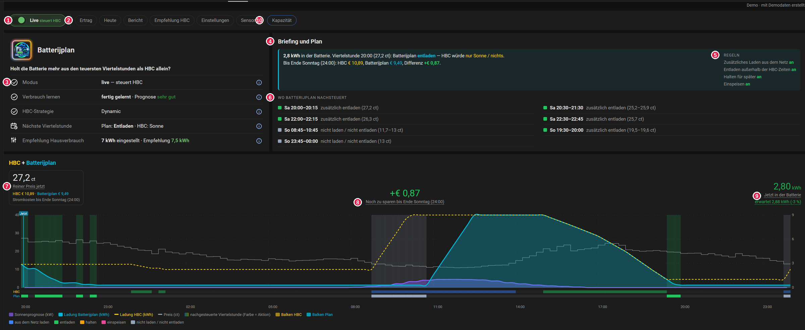
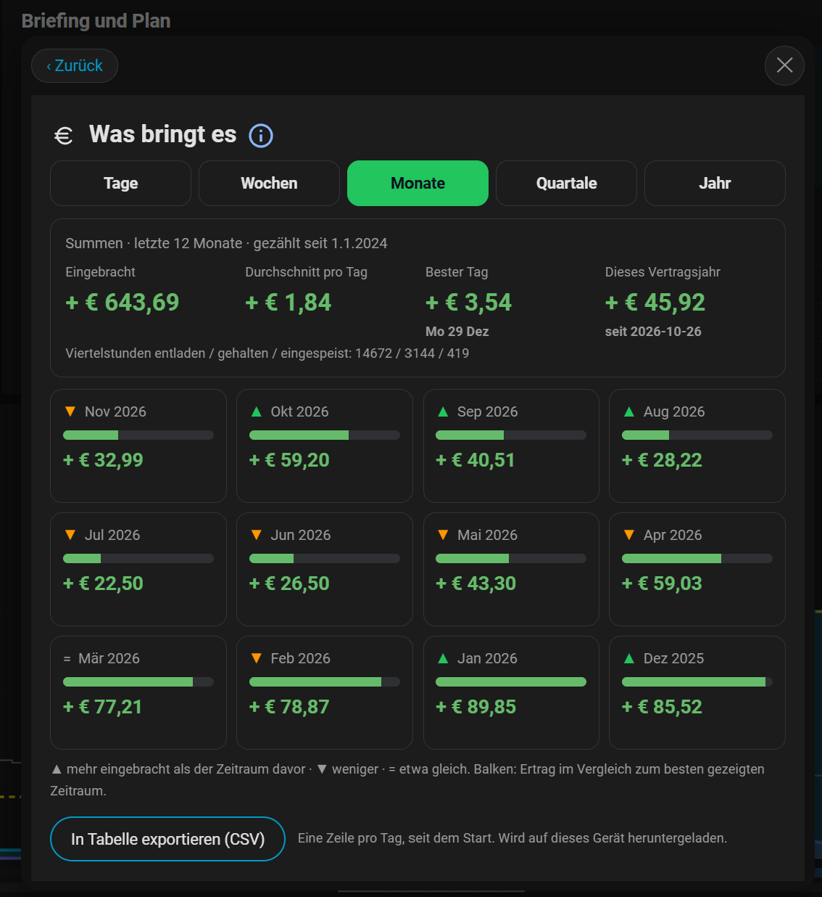
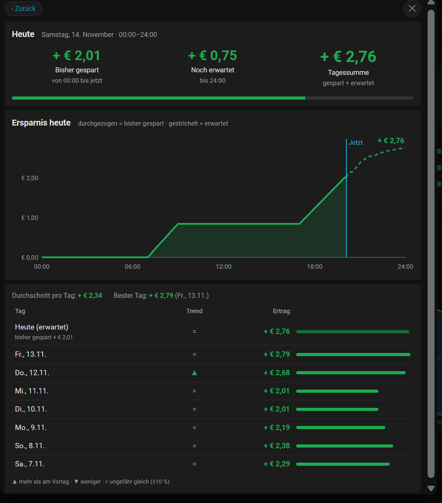
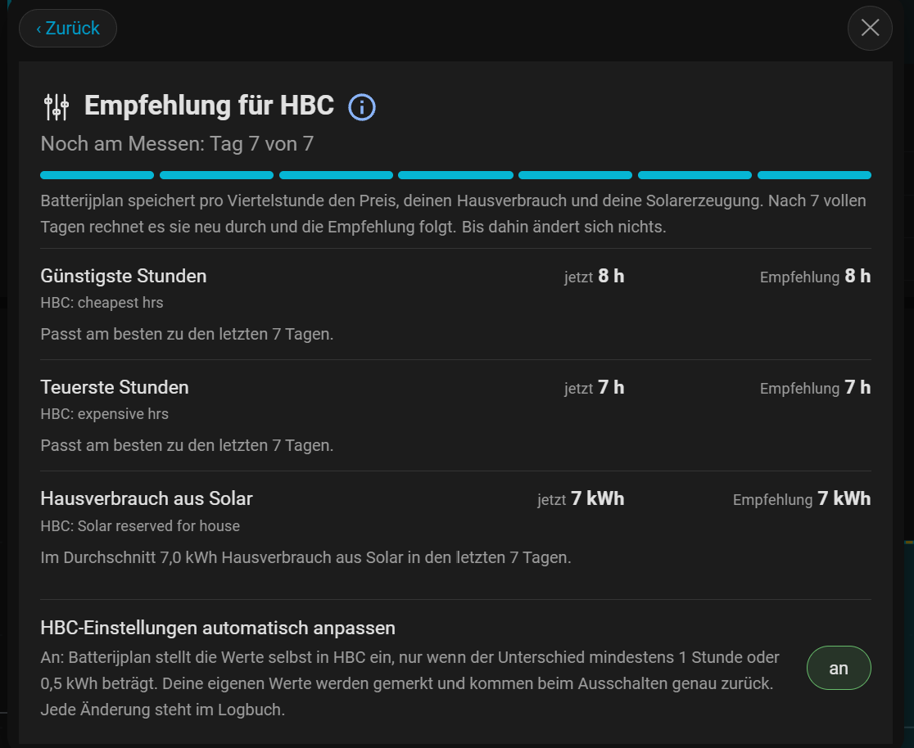
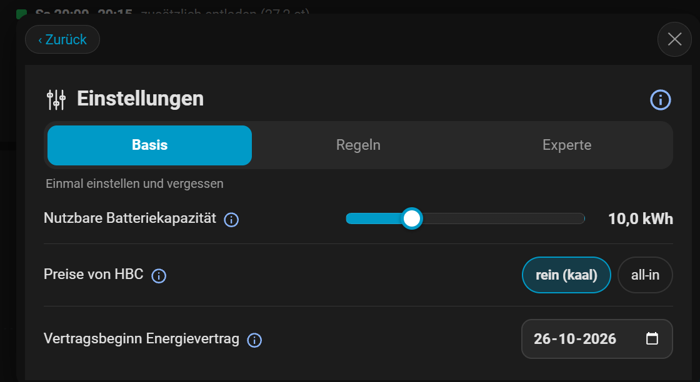
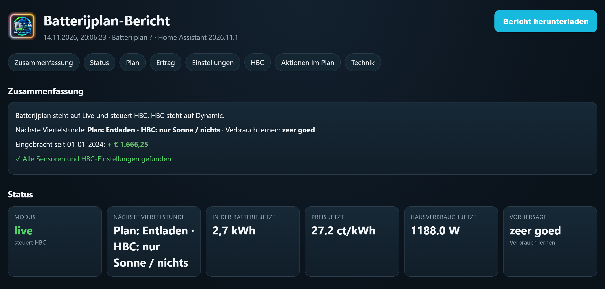
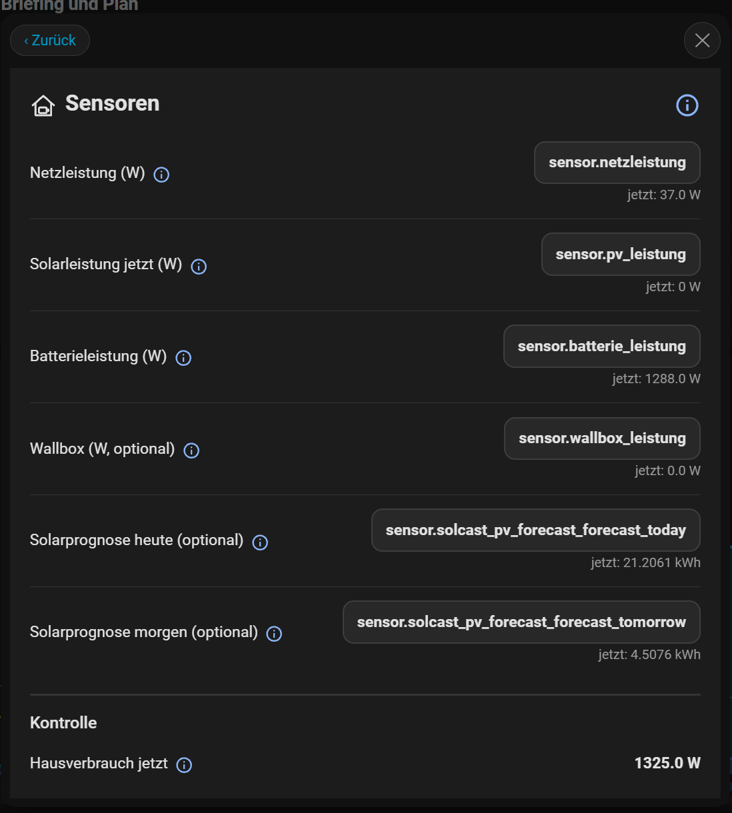
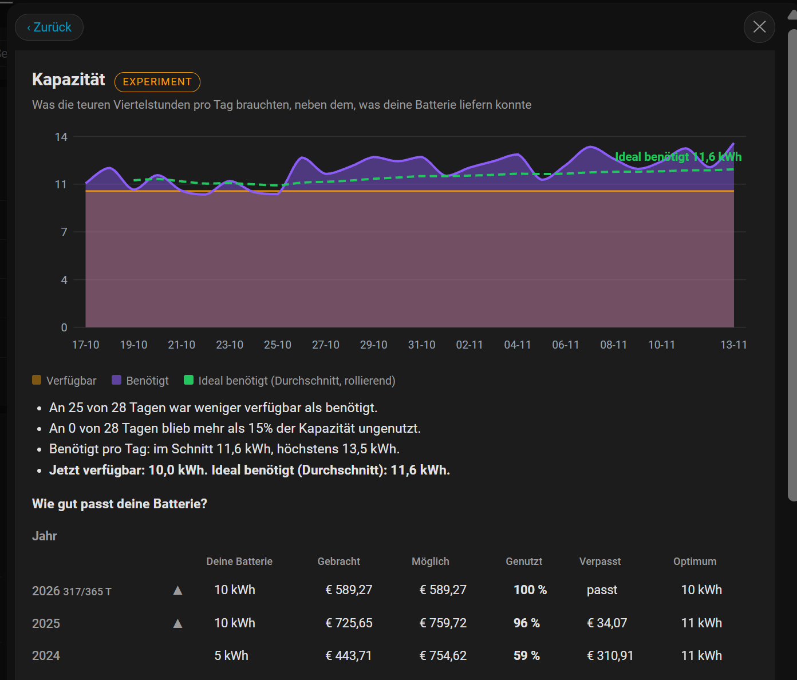
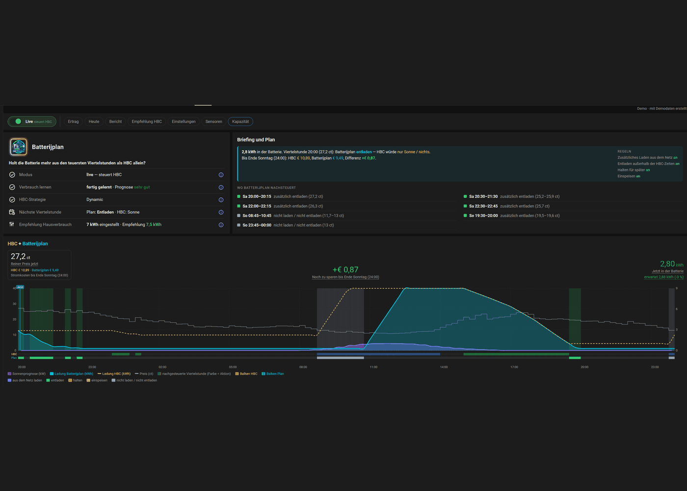

# 02 · Das Dashboard

*English: [02-dashboard.md](02-dashboard.md) · Nederlands: [02-dashboard.nl.md](02-dashboard.nl.md)*

**Kurz gesagt**
- Das Dashboard gehört zur Integration. Es steht in der Seitenleiste als **Batterijplan**, unter `/batterijplan`. Die Karten sind eingebaut: keine Ressource, keine Datei, nichts zum Einfügen.
- Die Startseite beantwortet eine Frage: *Was tut Batterijplan gerade, und holt es mehr aus dem Speicher als HBC allein?* Alles passt auf einen Bildschirm.
- Oben eine Reihe von Knöpfen. Ertrag, Heute, der Bericht, die Empfehlung für HBC, die Einstellungen, die Sensoren und das Kapazitätsexperiment liegen hinter einem Knopf und öffnen sich als Fenster.
- Jede eigene Karte hat ein **(i)** neben dem Titel, und auf der Statuskarte und in den Einstellungen hat auch jede Zeile eins. Klicke darauf für das Fenster *Wie liest man das?* Fahre mit der Maus über eine Zahl mit gepunkteter Linie für einen kurzen Hinweis.
- Die Farben sind überall gleich. Die Legende der Grafik erklärt sie.

Die Bilder auf dieser Seite sind mit Demodaten erstellt. Die Beträge sind Beispielzahlen.

1. **Live**: an = Batterijplan steuert HBC. Aus = Schattenmodus: es rechnet mit, steuert aber nichts.
2. **Knöpfe**: Ertrag, Heute, Bericht, Empfehlung HBC, Einstellungen und Sensoren. Jeder Knopf öffnet ein Fenster. Der orange Punkt auf **Empfehlung HBC** bedeutet, dass *cheapest hrs*, *expensive hrs* oder *Solar reserved for house* von der Empfehlung abweicht (um mindestens 1 Stunde oder 0,5 kWh); im Fenster steht auch der Schalter *HBC-Einstellungen automatisch anpassen*.
3. **Statuskarte**: Modus, Verbrauch lernen, HBC-Strategie, nächste Viertelstunde und Empfehlung Hausverbrauch. Das (i) hinter jeder Zeile erklärt sie.
4. **Briefing und Plan**: was jetzt in der Batterie ist, was der Plan in der nächsten Viertelstunde tut, und der Kostenunterschied zu HBC allein bis zum Ende des Plans.
5. **Regeln**: die vier Regeln (*Zusätzliches Laden aus dem Netz*, *Entladen außerhalb der HBC-Zeiten*, *Halten für später*, *Einspeisen*), jede mit eigenem Ein/Aus-Schalter.
6. **Wo Batterijplan nachsteuert**: die Blöcke, in denen der Plan etwas anderes tut als HBC, mit einer Farbe pro Aktion und dem Preis.
7. **Reiner Preis jetzt und die Stromkosten bis zum Ende des Plans**: HBC neben Batterijplan.
8. **Noch zu sparen bis Ende &lt;Tag&gt; (24:00)**: was Batterijplan gegenüber HBC allein noch spart, von jetzt bis zum Ende des Plans. Tippe darauf für das Fenster *Heute*.
9. **Batterie**: wie viele kWh jetzt in der Batterie sind, mit der erwarteten Ladung darunter.
10. **Kapazität** (blauer Rand = Experiment): passt deine Batterie zu deinem Haus? Ein oder aus unter *Einstellungen → Experte*.

## Die Knopfleiste

| Knopf | Was er tut |
|---|---|
| **Live** (eigener Schalter, ganz vorne) | Grün und an = Batterijplan steuert HBC. Aus = Schattenmodus: Es rechnet mit, steuert aber nichts. |
| **Ertrag** | Öffnet *Was bringt es*: Tage, Wochen, Monate, Quartale und Jahre. |
| **Heute** | Öffnet *Heute*: bisher gespart, noch erwartet und die Tagessumme. |
| **Empfehlung HBC** | Öffnet *Empfehlung für HBC*. |
| **Einstellungen** | Öffnet die Einstellungen, mit den Reitern **Basis**, **Regeln** und **Experte**. |
| **Bericht** | Öffnet den Bericht des Plans. |
| **Sensoren** | Öffnet die Sensornamen, die Kontrolle *Hausverbrauch jetzt* und die Erklärung. |
| **Kapazität** (blauer Rand) | Öffnet das Kapazitätsexperiment. Siehe [06 · Kapazitätsempfehlung](06-capacity.de.md). |

Ein **orangefarbener Punkt** auf einem Knopf bedeutet: Hier ist etwas zu tun. Zum Beispiel eine Einstellung, die nicht ausgefüllt ist, oder ein Sensor, der nichts meldet. Kein Punkt bedeutet, dass alles passt.

Ein Fenster schließt du mit **‹ Zurück** oder ✕ oben, mit einem Klick daneben oder mit Esc. Das Fenster *Wie liest man das?* schließt du genauso; du kommst dann dorthin zurück, wo du warst.

## Statuskarte

Oben das Logo, der Name und die Version, mit der Frage, die Batterijplan beantwortet. Jede Zeile hat rechts ein **(i)** mit einer Erklärung.

| Zeile | Bedeutung |
|---|---|
| Modus | **live** — steuert HBC, oder **Schatten** — rechnet mit, steuert nichts. |
| Verbrauch lernen | Beim Lernen zum Beispiel "lernen · Tag 3 von 7 · Prognose ordentlich". Nach 7 Tagen: "Lernen abgeschlossen · Prognose gut". |
| HBC-Strategie | Muss **Dynamic** sein. Steht dort etwas anderes? Dann steuert Batterijplan nichts. |
| Nächste Viertelstunde | Was der Plan in der nächsten Viertelstunde tut, neben dem, was HBC allein täte. |

**Die Prognose** sagt, wie gut der gelernte Verbrauch zum echten Verbrauch passt, pro Block von 3 Stunden. Du siehst nur ein Urteil, keinen Prozentwert:

| Urteil | Farbe |
|---|---|
| noch am Messen | normaler Text |
| wechselhaft | normaler Text |
| ordentlich | hellgrün |
| gut | grün |
| sehr gut | dunkelgrün |
| ausgezeichnet | das dunkelste Grün |

## Das Briefing

- Oben drei Zahlen: **Reiner Preis jetzt**, **Noch zu sparen bis Ende &lt;Tag&gt; (24:00)** und **Jetzt in der Batterie**.
- *Jetzt in der Batterie* folgt der Batterie live (Schritte von 0,1 kWh); der Plan und das Diagramm behalten die geplante Ladung.
- Darunter **Wo Batterijplan nachsteuert**: die Blöcke in Worten, in denen der Plan etwas anderes tut als HBC, zum Beispiel "Di 08:30–10:30 für später halten". Nichts zu tun: HBC macht sein Übliches.
- Rechts die **Regeln**: die vier Regeln, jede mit eigenem Ein/Aus-Schalter. Siehe [03 · So funktioniert es](03-how-it-works.de.md#die-regeln).
- Der Plan schaut höchstens 36 Stunden voraus. Morgen erscheint, sobald HBC die Preise von morgen hat (meist gegen 13:00 Uhr).

## Die Grafik

Die Grafik steht über die volle Breite und zeigt HBC allein und Batterijplan nebeneinander.

- Die graue Linie ist der reine Strompreis pro Viertelstunde, so wie HBC ihn liefert.
- Die farbigen Flächen sind die Viertelstunden, in denen Batterijplan etwas tut.
- Die **Ladung** in kWh: was die Batterie mit HBC allein täte und was sie mit dem Plan tut. Die erwartete Sonne ist die beste Schätzung von Solcast.
- Die Linie *Jetzt* trennt Vergangenheit und Zukunft. Links davon ist es leicht abgedunkelt.
- Die **Datumsauswahl** steht rechts in der Kopfzeile. Wähle *Jetzt* oder einen anderen Tag und blättere mit ‹ ›.
- Der Kopf zeigt die Zahlen: die Fakten, die Ersparnis und die kWh.
- Fahre mit der Maus über die Grafik (auf dem Handy: tippe darauf). Eine senkrechte Linie folgt dem Zeiger, und ein kleines Feld zeigt für diese Viertelstunde: die Uhrzeit, den reinen Preis (ct), die erwartete Sonne in kW (die normale Schätzung und die vorsichtige Schätzung, die der Plan verwendet), die Ladung von HBC und von Batterijplan (kWh) und was HBC und Batterijplan tun. Nur die Linie und das Feld bewegen sich, die Karte wird nicht neu gezeichnet. Auf dem Handy verschwindet das Feld, wenn du woanders tippst.

**Der Unterschied zu HBC allein** steht in Euro. Mehr als 0 zeigt **+ 0,35 €** in grün, genau 0 zeigt **0,00 €** in grau, weniger als 0 zeigt **– 0,02 €** in orange. Dieselbe Regel gilt für die Beträge in *Was bringt es*.

## Fenster hinter den Knöpfen

**Was bringt es**

Fünf Reiter: **Tage**, **Wochen**, **Monate**, **Quartale** und **Jahr**. Jeder Reiter zeigt die Zeiträume von neu nach alt, mit einem Trendpfeil und einem Balken.

| Zeile | Bedeutung |
|---|---|
| Eingebracht | Was Batterijplan zusätzlich zu HBC allein einbrachte, während es wirklich steuerte (*Live* an). |
| Durchschnitt pro Tag | Dasselbe, pro Tag. |
| Bester Tag | Der Tag, der am meisten einbrachte. |
| Dieses Vertragsjahr | Dasselbe, ab dem Beginn deines Vertragsjahres. |
| Viertelstunden entladen / gehalten / eingespeist | Wie oft Batterijplan jedes der drei Dinge tat. |

▲ bedeutet mehr als der Zeitraum davor, ▼ weniger, = etwa gleich. **In Tabelle exportieren (CSV)** lädt eine Zeile pro Tag herunter, seit dem Start.

Es ist eine Schätzung: siehe [03 · So funktioniert es](03-how-it-works.de.md).

**Heute**

Der Kalendertag von 00:00 bis 24:00. **Bisher gespart** ist, was Batterijplan seit Mitternacht gespart hat, **Noch erwartet**, was der Plan bis 24:00 noch erwartet, und **Tagessumme** beides zusammen. Die Grafik zeigt die Ersparnis über den Tag: durchgezogen ist gespart, gestrichelt ist erwartet. Darunter heute und die letzten 7 Tage, mit dem Durchschnitt und dem besten Tag.

**Empfehlung für HBC**

Die Empfehlung für *cheapest hrs*, *expensive hrs* und *Solar reserved for house*, nach 7 Tagen Messen. Siehe [03 · So funktioniert es](03-how-it-works.de.md).

**Einstellungen**

Drei Reiter, mit eigenen Eingabefeldern und einem (i) neben jedem Feld:

| Reiter | Was darauf ist |
|---|---|
| **Basis** — einstellen und vergessen | Nutzbare Kapazität, Sicherheitsmarge, *Preise von HBC* (*rein* oder *all-in*), Aufschlag und Vertragsbeginn. |
| **Regeln** | Die vier Regeln mit ihrem Ein/Aus-Schalter. |
| **Experte** — nur ändern, wenn du weißt warum | MwSt., Einspeise-Aufschlag, Tages-Einspeisebonus und die Stunden für diesen Bonus, *HBC-Einstellungen automatisch anpassen* und *Experiment Kapazität*. |

Hier liegt auch der Schalter *HBC-Einstellungen automatisch* (standardmäßig aus): Er setzt die drei HBC-Einstellungen auf die Empfehlung und stellt deine eigenen Werte wieder her, wenn du ihn ausschaltest. Die zwei Felder für die Solarprognose-Sensoren liegen im Fenster *Sensoren*.

Die Erklärung zu jedem Feld steht auch in [01 · Installation](01-installation.de.md#schritt-3--integration-hinzufügen). Alle Einstellungen werden von der Integration gespeichert: siehe [04 · Wartung](04-maintenance.de.md#backup).

**Bericht**

Der schriftliche Bericht: Zusammenfassung, Status, Plan, Ertrag, Einstellungen, HBC, Aktionen im Plan und Technik. Mit eingeschaltetem Kapazitätsexperiment zeigt der Bericht auch die Kapazität pro Jahr, Quartal und Monat. **Bericht ansehen** öffnet ihn in einem neuen Tab, **Herunterladen (.html)** speichert ihn, **Für GitHub kopieren** und **Issue auf GitHub öffnen** helfen, wenn du ein Problem meldest.

**Sensoren**

Die Namen deiner Sensoren für Netz, Sonne, Batterie und (optional) Ladestation. Unter jedem Namen siehst du, was dieser Sensor jetzt meldet. Unten die Kontrolle *Hausverbrauch jetzt*.

**Kapazität** (Experiment)

War deine Batterie groß genug für die teuren Viertelstunden, und was hätte eine andere Kapazität gebracht? Alles dazu: [06 · Kapazitätsempfehlung](06-capacity.de.md).

## In Bewegung

## Dein eigenes Dashboard

Die Entitäten haben feste Namen (`sensor.batterijplan`, `switch.batterijplan_live` und so weiter) und die Karten werden überall in Home Assistant geladen. Du kannst die Karten also auch in deinen eigenen Dashboards nutzen. Die Karten kommen in vier Dateien: `batterijplan-cards.js`, `batterijplan-plan-card.js`, `batterijplan-vandaag-cards.js` und `batterijplan-capaciteit-card.js`. Die Karten haben eine optionale Einstellung `taal` (`nl`, `en` oder `de`), die die Sprache dieser Karte festlegt; ohne sie folgt die Karte der Sprache deines Home-Assistant-Profils.
