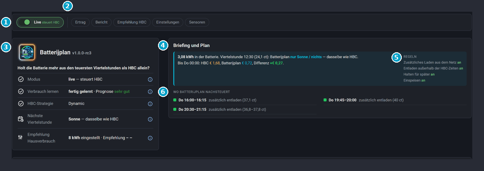

# 02 · Das Dashboard

*English: [02-dashboard.md](02-dashboard.md) · Nederlands: [02-dashboard.nl.md](02-dashboard.nl.md)*

**Kurz gesagt**
- Das Dashboard gehört zur Integration. Es steht in der Seitenleiste als **Batterijplan**, unter `/batterijplan`. Die Karten sind eingebaut: keine Ressource, keine Datei, nichts zum Einfügen.
- Die Startseite beantwortet eine Frage: *Was tut Batterijplan gerade, und holt es mehr aus dem Speicher als HBC allein?* Alles passt auf einen Bildschirm.
- Oben eine Reihe von Knöpfen. Ertrag, Einstellungen, der Bericht und die Sensoren liegen hinter einem Knopf und öffnen sich als Fenster.
- Jede eigene Karte hat ein **(i)** neben dem Titel, und auf der Statuskarte und in den Einstellungen hat auch jede Zeile eins. Klicke darauf für das Fenster *Wie liest man das?* Fahre mit der Maus über eine Zahl mit gepunkteter Linie für einen kurzen Hinweis.
- Die Farben sind überall gleich. Die Legende der Grafik erklärt sie.

1. **Live**: an = Batterijplan steuert HBC. Aus = Schattenmodus: es rechnet mit, steuert aber nichts.
2. **Knöpfe**: Ertrag, Bericht, Empfehlung HBC, Einstellungen und Sensoren. Jeder Knopf öffnet ein Fenster.
3. **Statuskarte**: Modus, Verbrauch lernen, HBC-Strategie, nächste Viertelstunde und Empfehlung Hausverbrauch. Das (i) hinter jeder Zeile erklärt sie.
4. **Briefing und Plan**: was jetzt in der Batterie ist, was der Plan in der nächsten Viertelstunde tut, und der Unterschied zu HBC allein.
5. **Regeln**: die vier Regeln, jede mit eigenem Ein/Aus-Schalter.
6. **Wo Batterijplan nachsteuert**: die Blöcke, in denen der Plan etwas anderes tut als HBC.

Die Seite hat vier Teile:
1. die Knopfleiste;
2. die Statuskarte;
3. das Briefing, in zwei Spalten, mit den Regeln rechts;
4. die Grafik über die volle Breite: HBC allein und Batterijplan.

## Die Knopfleiste

| Knopf | Was er tut |
|---|---|
| **Live** (eigener Schalter, ganz vorne) | Grün und an = Batterijplan steuert HBC. Aus = Schattenmodus: Es rechnet mit, steuert aber nichts. |
| **Ertrag** | Öffnet *Was bringt es*. |
| **Einstellungen** | Öffnet die Einstellungen, mit den Reitern **Basis**, **Regeln** und **Experte**. |
| **Bericht** | Öffnet den Bericht des Plans. |
| **Sensoren** | Öffnet die Sensornamen, die Kontrolle *Hausverbrauch jetzt* und die Erklärung. |

Ein **orangefarbener Punkt** auf einem Knopf bedeutet: Hier ist etwas zu tun. Zum Beispiel eine Einstellung, die nicht ausgefüllt ist, oder ein Sensor, der nichts meldet. Kein Punkt bedeutet, dass alles passt.

Ein Fenster schließt du mit **‹ Zurück** oder ✕ oben, mit einem Klick daneben oder mit Esc. Das Fenster *Wie liest man das?* schließt du genauso; du kommst dann dorthin zurück, wo du warst.

## Statuskarte

Oben das Logo, der Name und die Version, mit der Frage, die Batterijplan beantwortet. Jede Zeile hat rechts ein **(i)** mit einer Erklärung.

| Zeile | Bedeutung |
|---|---|
| Modus | **live** — steuert HBC, oder **Schatten** — rechnet mit, steuert nichts. |
| Verbrauch lernen | Beim Lernen zum Beispiel "lernen · Tag 3 von 7 · Prognose ordentlich". Nach 7 Tagen: "Lernen abgeschlossen · Prognose gut". |
| HBC-Strategie | Muss **Dynamic** sein. Steht dort etwas anderes? Dann steuert Batterijplan nichts. |
| Nächste Viertelstunde | Was der Plan in der nächsten Viertelstunde tut, neben dem, was HBC allein täte. |

**Die Prognose** sagt, wie gut der gelernte Verbrauch zum echten Verbrauch passt, pro Block von 3 Stunden. Du siehst nur ein Urteil, keinen Prozentwert:

| Urteil | Farbe |
|---|---|
| noch am Messen | normaler Text |
| wechselhaft | normaler Text |
| ordentlich | hellgrün |
| gut | grün |
| sehr gut | dunkelgrün |
| ausgezeichnet | das dunkelste Grün |

## Das Briefing

- Oben drei Zahlen: **Reiner Preis jetzt**, **Erwartete Ersparnis gegenüber HBC allein** und **Jetzt in der Batterie**.
- Darunter **Wo Batterijplan nachsteuert**: die Blöcke in Worten, in denen der Plan etwas anderes tut als HBC, zum Beispiel "Di 08:30–10:30 für später halten". Nichts zu tun: HBC macht sein Übliches.
- Rechts die **Regeln**: die vier Regeln, jede mit eigenem Ein/Aus-Schalter. Siehe [03 · So funktioniert es](03-how-it-works.de.md#die-regeln).
- Der Plan schaut höchstens 36 Stunden voraus. Morgen erscheint, sobald HBC die Preise von morgen hat (meist gegen 13:00 Uhr).

## Die Grafik

Die Grafik steht über die volle Breite und zeigt HBC allein und Batterijplan nebeneinander.

- Die graue Linie ist der reine Strompreis pro Viertelstunde, so wie HBC ihn liefert.
- Die farbigen Flächen sind die Viertelstunden, in denen Batterijplan etwas tut.
- Die **Ladung** in kWh: was die Batterie mit HBC allein täte und was sie mit dem Plan tut. Die erwartete Sonne ist die beste Schätzung von Solcast.
- Die Linie *Jetzt* trennt Vergangenheit und Zukunft. Links davon ist es leicht abgedunkelt.
- Die **Datumsauswahl** steht rechts in der Kopfzeile. Wähle *Jetzt* oder einen anderen Tag und blättere mit ‹ ›.
- Der Kopf zeigt die Zahlen: die Fakten, die Ersparnis und die kWh.
- Fahre mit der Maus über die Grafik für den Preis, was die Batterie tut und die Ladung in dieser Viertelstunde.

**Der Unterschied zu HBC allein** steht in Euro. Mehr als 0 zeigt **+ 0,35 €** in grün, genau 0 zeigt **0,00 €** in grau, weniger als 0 zeigt **– 0,02 €** in orange. Dieselbe Regel gilt für die Beträge in *Was bringt es*.

## Fenster hinter den Knöpfen

**Was bringt es**

| Zeile | Bedeutung |
|---|---|
| Gesamt seit … | Der geschätzte Mehrwert zusätzlich zu HBC allein. |
| Dieses Vertragsjahr | Dasselbe, ab dem Beginn deines Vertragsjahres. |
| davon Schatten | Was es gebracht hätte, während *Live* aus war. Dieses Geld hast du nicht wirklich verdient. |
| davon live | Was es brachte, während Batterijplan wirklich steuerte. |
| Viertelstunden gehalten / eingespeist / entladen | Wie oft Batterijplan jedes der drei Dinge getan hat. |

Es ist eine Schätzung: siehe [03 · So funktioniert es](03-how-it-works.de.md#der-zähler-mehrwert).

**Einstellungen**

Drei Reiter, mit eigenen Eingabefeldern und einem (i) neben jedem Feld:

| Reiter | Was darauf ist |
|---|---|
| **Basis** — einstellen und vergessen | Nutzbare Kapazität, Sicherheitsmarge, *Preise von HBC* (*rein* oder *all-in*), Aufschlag und Vertragsbeginn. |
| **Regeln** | Die vier Regeln mit ihrem Ein/Aus-Schalter. |
| **Experte** — nur ändern, wenn du weißt warum | MwSt., Einspeise-Aufschlag, Tages-Einspeisebonus und die Stunden für diesen Bonus. |

Die Erklärung zu jedem Feld steht auch in [01 · Installation](01-installation.de.md#schritt-3--integration-hinzufügen). Alle Einstellungen werden von der Integration gespeichert: siehe [04 · Wartung](04-maintenance.de.md#backup).

**Bericht**

Der geschriebene Bericht des Plans.

**Sensoren**

Die Namen deiner Sensoren für Netz, Sonne, Batterie und (optional) Ladestation. Unter jedem Namen siehst du, was dieser Sensor jetzt meldet. Unten die Kontrolle *Hausverbrauch jetzt*.

## Dein eigenes Dashboard

Die Entitäten haben feste Namen (`sensor.batterijplan`, `switch.batterijplan_live` und so weiter) und die Karten werden überall in Home Assistant geladen. Du kannst die Karten also auch in deinen eigenen Dashboards nutzen. Die Karten kommen in zwei Dateien, `batterijplan-cards.js` und `batterijplan-plan-card.js`. Die Karten haben eine optionale Einstellung `taal` (`nl`, `en` oder `de`), die die Sprache dieser Karte festlegt; ohne sie folgt die Karte der Sprache deines Home-Assistant-Profils.
