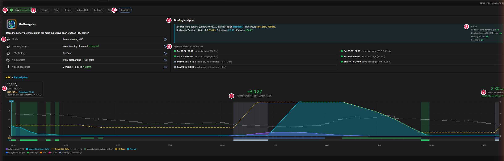
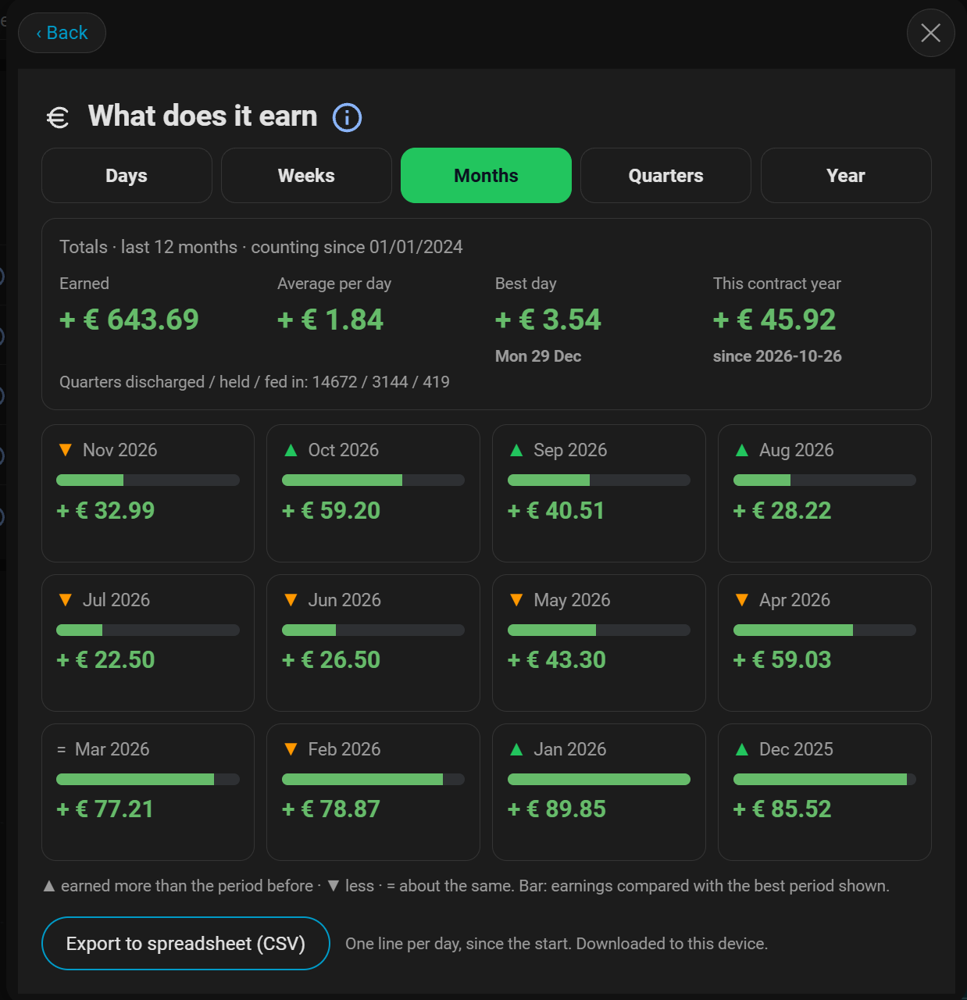
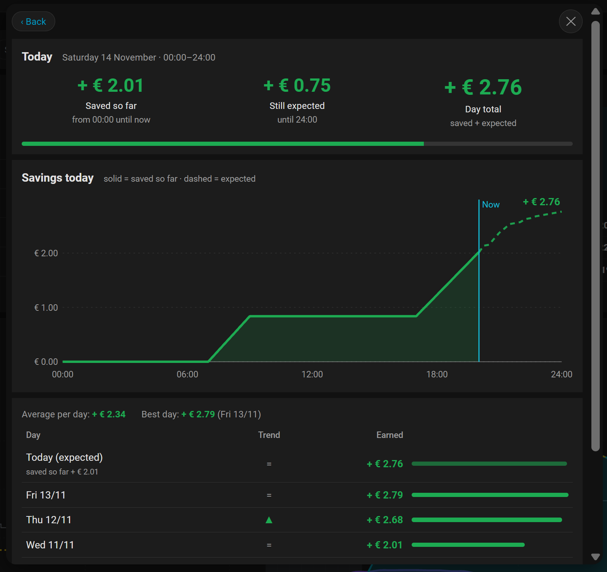
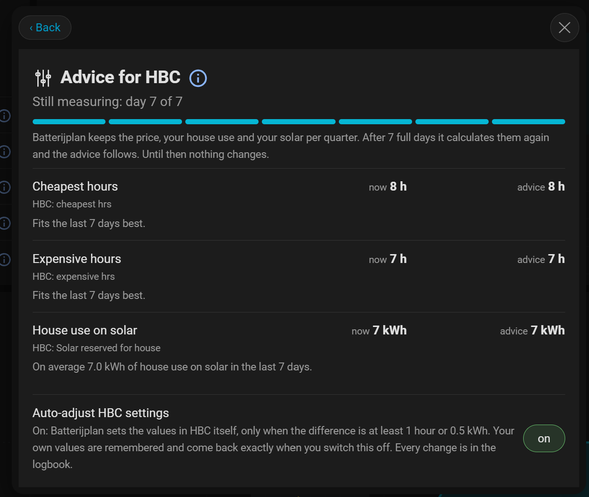
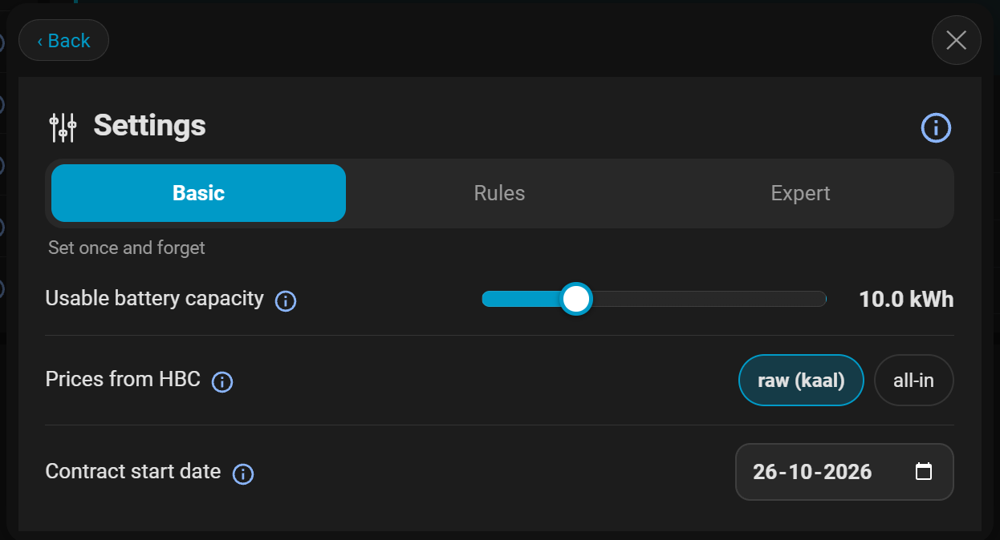
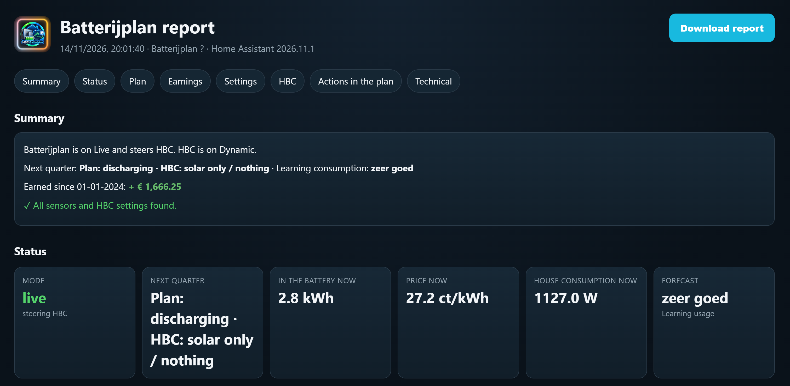
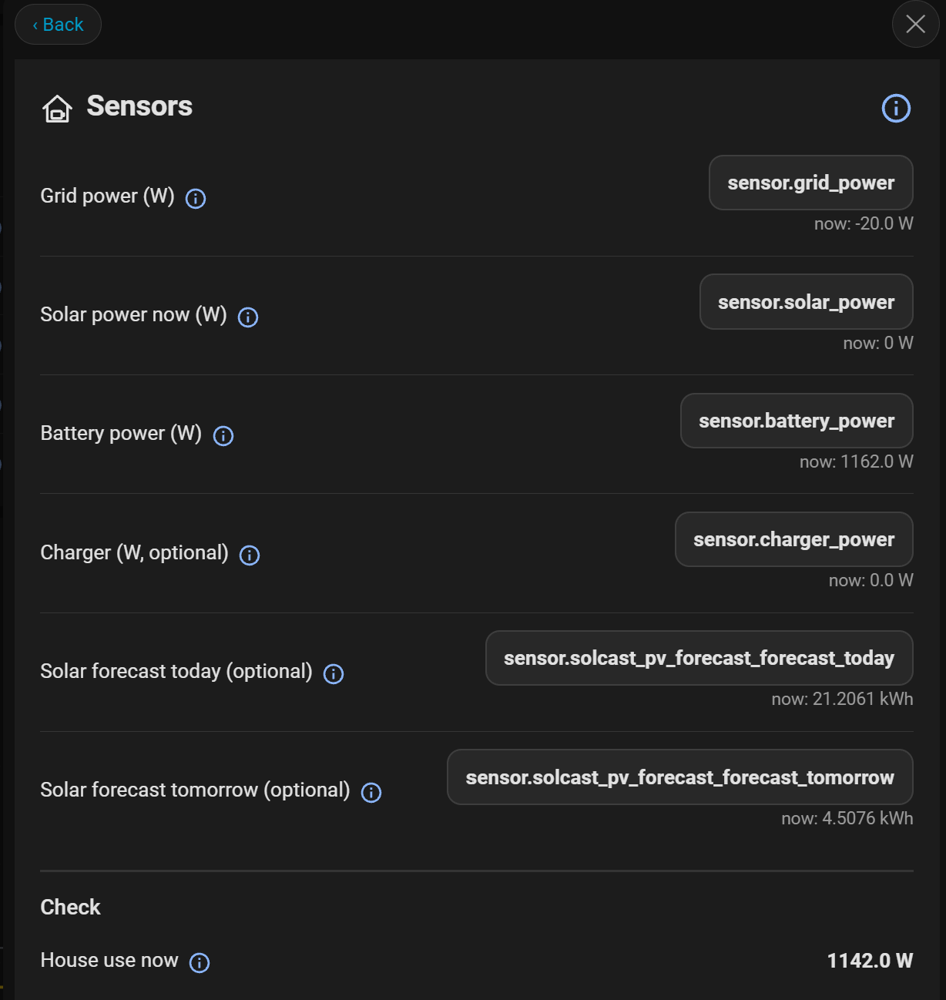
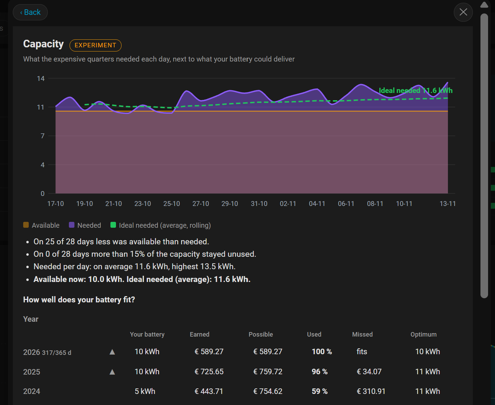
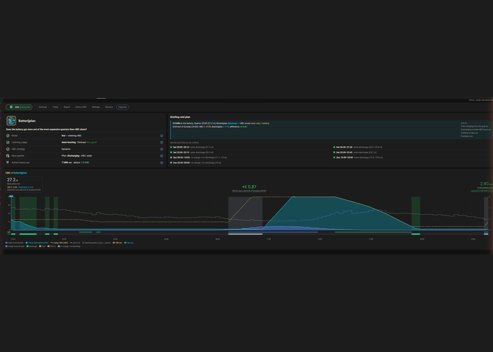

# 02 · The dashboard

*Nederlands: [02-dashboard.nl.md](02-dashboard.nl.md) · Deutsch: [02-dashboard.de.md](02-dashboard.de.md)*

**In short**
- The dashboard comes with the integration. It is in the sidebar as **Batterijplan**, at `/batterijplan`. The cards are built in: no resource, no file, nothing to paste.
- The start page answers one question: *what is Batterijplan doing now, and does it get more out of the battery than HBC alone?* Everything fits on one screen.
- At the top there is a row of buttons. Earnings, today, the report, the advice for HBC, the settings, the sensors and the capacity experiment sit behind a button and open as a window.
- Every custom card has an **(i)** next to its title, and on the status card and in the settings every line has one too. Click it for the *How to read this?* window. Hover over a number with a dotted underline for a short note.
- The colours are the same everywhere. The legend of the chart explains them.

The pictures on this page are made with demo data. The amounts are example figures.

1. **Live**: on = Batterijplan steers HBC. Off = shadow mode: it calculates along, but steers nothing.
2. **Buttons**: Earnings, Today, Report, Advice HBC, Settings and Sensors. Each button opens a window. The orange dot on **Advice HBC** means that *cheapest hrs*, *expensive hrs* or *Solar reserved for house* differs from the advice (by at least 1 hour or 0.5 kWh); the window also has the switch *Auto-adjust HBC settings*.
3. **Status card**: mode, learning usage, HBC strategy, next quarter and advice house use. The (i) behind each line explains it.
4. **Briefing and plan**: what is in the battery now, what the plan does in the next quarter, and the difference in cost with HBC alone until the end of the plan.
5. **Rules**: the four rules (*Extra charging from the grid*, *Discharging outside HBC hours*, *Holding for later*, *Feeding in*), each with its own on/off switch.
6. **Where Batterijplan steers**: the blocks in which the plan does something different from HBC, with a colour for each action and the price.
7. **Bare price now and the electricity cost until the end of the plan**: HBC next to Batterijplan.
8. **Still to save until end of &lt;day&gt; (24:00)**: what Batterijplan still saves compared with HBC alone, from now until the end of the plan. Tap it for the *Today* window.
9. **Battery**: how many kWh are in the battery now, with the expected charge below it.
10. **Capacity** (blue border = experiment): does your battery fit your house? Switch it on or off in *Settings → Expert*.

## The row of buttons

| Button | What it does |
|---|---|
| **Live** (its own switch, at the front) | Green and on = Batterijplan steers HBC. Off = shadow mode: it calculates along, but steers nothing. |
| **Earnings** | Opens *What does it earn*: days, weeks, months, quarters and years. |
| **Today** | Opens *Today*: saved so far, still expected and the day total. |
| **Advice HBC** | Opens *Advice for HBC*. |
| **Settings** | Opens the settings, with the tabs **Basic**, **Rules** and **Expert**. |
| **Report** | Opens the report of the plan. |
| **Sensors** | Opens the sensor names, the check *house usage now* and the explanation. |
| **Capacity** (blue border) | Opens the capacity experiment. See [06 · Capacity advice](06-capacity.md). |

An **orange dot** on a button means: there is something to do here. For example a setting that is not filled in or a sensor that reports nothing. No dot means everything is set up correctly.

You close a window with **‹ Back** or ✕ at the top, by clicking next to it or with Esc. You close the *How to read this?* window the same way; you then return to where you were.

## Status card

At the top the logo, the name and the version, with the question Batterijplan answers. Every line has an **(i)** on the right with an explanation.

| Line | Meaning |
|---|---|
| Mode | **live** — steers HBC, or **shadow** — calculates along, steers nothing. |
| Learning usage | While learning, for example "learning · day 3 of 7 · forecast fair". After 7 days: "done learning · forecast good". |
| HBC strategy | Must be **Dynamic**. Shows something else? Then Batterijplan steers nothing. |
| Next quarter | What the plan does in the next quarter of an hour, next to what HBC alone would do. |

**The forecast** says how well the learned usage matches the real usage, per block of 3 hours. You only see a verdict, not a percentage:

| Verdict | Colour |
|---|---|
| still measuring | normal text |
| variable | normal text |
| fair | light green |
| good | green |
| very good | dark green |
| excellent | the darkest green |

## The briefing

- At the top three numbers: **Bare price now**, **Still to save until end of &lt;day&gt; (24:00)** and **In the battery now**.
- *In the battery now* follows the battery live (steps of 0.1 kWh); the plan and the chart keep the planned charge.
- Then **Where Batterijplan steers**: the blocks in words in which the plan does something different from HBC, for example "Tue 08:30–10:30 holding for later". Nothing to do: HBC does its usual thing.
- On the right the **Rules**: the four rules, each with its own on/off switch. See [03 · How it works](03-how-it-works.md#the-rules).
- The plan covers the next 36 hours at most. Tomorrow appears as soon as HBC has tomorrow's prices (usually around 13:00).

## The chart

The chart is across the full width and shows HBC alone and Batterijplan side by side.

- The grey line is the bare electricity price per quarter, as HBC gives it.
- The coloured areas are the quarters in which Batterijplan does something.
- The **charge** in kWh: what the battery would do with HBC alone, and what it does with the plan. The expected sun is the Solcast best estimate.
- The line *Now* splits the past from the future. Left of it is slightly dimmed.
- The **date picker** is on the right in the header. Choose *Now* or another day and browse with ‹ ›.
- The header shows the numbers: the facts, the saving and the kWh.
- Hover over the chart (on a phone: tap it). A vertical line follows your pointer and a small box shows for that quarter: the time, the bare price (ct), the expected solar in kW (the normal estimate and the cautious estimate the plan uses), the charge of HBC and of Batterijplan (kWh), and what HBC and Batterijplan do. Only the line and the box move; the card is not redrawn. On a phone the box goes away when you tap elsewhere.

**The difference with HBC alone** is shown in euros. More than 0 shows as **+ € 0.35** in green, exactly 0 as **€ 0.00** in grey, less than 0 as **– € 0.02** in orange. The same rule applies to the amounts in *What does it earn*.

## Windows behind the buttons

**What does it earn**

Five tabs: **Days**, **Weeks**, **Months**, **Quarters** and **Year**. Each tab shows the periods from new to old, with a trend arrow and a bar.

| Line | Meaning |
|---|---|
| Earned | What Batterijplan added on top of HBC alone while it was really steering (*Live* on). |
| Average per day | The same, per day. |
| Best day | The day that added the most. |
| This contract year | The same, from the start date of your contract year. |
| Quarters discharged / held / fed in | How often Batterijplan did each of the three things. |

▲ means more than the period before, ▼ less, = about the same. **Export to spreadsheet (CSV)** downloads one line per day, since the start.

It is an estimate: see [03 · How it works](03-how-it-works.md#the-counter-added-value).

**Today**

The calendar day from 00:00 to 24:00. **Saved so far** is what Batterijplan saved since midnight, **Still expected** what the plan still expects until 24:00, and **Day total** both together. The chart shows the saving over the day: solid is saved, dashed is expected. Below it today and the last 7 days, with the average and the best day.

**Advice for HBC**

The advice for *cheapest hrs*, *expensive hrs* and *Solar reserved for house*, after 7 days of measuring. See [03 · How it works](03-how-it-works.md).

**Settings**

Three tabs, with their own input fields and an (i) next to every field:

| Tab | What is on it |
|---|---|
| **Basic** — set and forget | Usable capacity, safety margin, *Prices from HBC* (*raw* or *all-in*), supplier mark-up and contract start date. |
| **Rules** | The four rules with their on/off switch. |
| **Expert** — only change if you know why | VAT, feed-in add-on, daytime feed-in bonus and the hours for that bonus, *Auto-adjust HBC settings* and *Capacity experiment*. |

The switch *Auto-adjust HBC settings* (off by default) is here too: it sets the three HBC settings to the advice and puts your own values back when you turn it off. The two fields for the solar forecast sensors are in the *Sensors* window.

The explanation for each field is also in [01 · Installation](01-installation.md#step-3--add-the-integration). All settings are kept by the integration: see [04 · Maintenance](04-maintenance.md#back-up).

**Report**

The written report: summary, status, plan, earnings, settings, HBC, actions in the plan and the technical details. With the capacity experiment on, the report also shows the capacity per year, quarter and month. **View report** opens it in a new tab, **Download (.html)** saves it, **Copy for GitHub** and **Open an issue on GitHub** help when you report a problem.

**Sensors**

The names of your sensors for grid, sun, battery and (optionally) EV charger. Below each name you see what that sensor reports now. At the bottom the check *house usage now*.

**Capacity** (experiment)

Was your battery big enough for the expensive quarters, and what would another capacity have earned? Everything about it: [06 · Capacity advice](06-capacity.md).

## In motion

## Your own dashboard

The entities have fixed names (`sensor.batterijplan`, `switch.batterijplan_live`, and so on) and the cards are loaded everywhere in Home Assistant. You can therefore also use the cards in your own dashboards. The cards come in four files: `batterijplan-cards.js`, `batterijplan-plan-card.js`, `batterijplan-vandaag-cards.js` and `batterijplan-capaciteit-card.js`. The cards have an optional option `taal` (`nl`, `en` or `de`) that sets the language of that card; without it the card follows the language of your Home Assistant profile.
