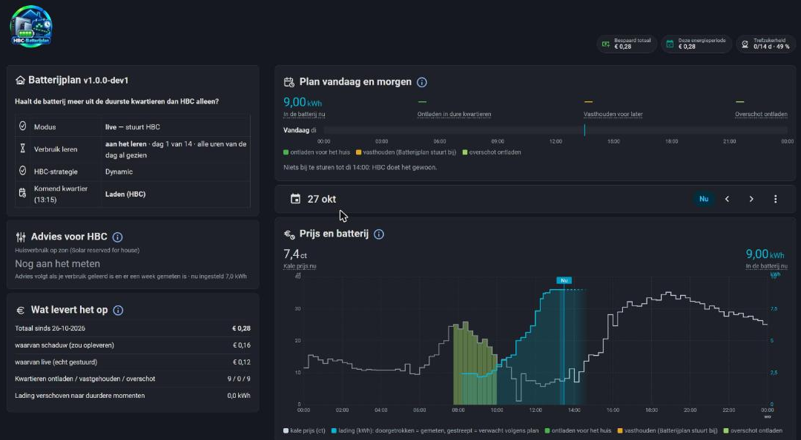

# 02 · The dashboard

*Nederlands: [02-dashboard.nl.md](02-dashboard.nl.md) · Deutsch: [02-dashboard.de.md](02-dashboard.de.md)*

**In short**
- The dashboard comes with the integration. It is in the sidebar as **Batterijplan**, at `/batterijplan`. The cards are built in: no resource, no file, nothing to paste.
- The start page answers one question: *what is Batterijplan doing now, and does it get more out of the battery than HBC alone?* Everything fits on one screen.
- At the top there is a row of buttons. Earnings, settings, the report and the sensors sit behind a button and open as a window.
- Every custom card has an **(i)** next to its title, and on the status card and in the settings every line has one too. Click it for the *How to read this?* window. Hover over a number with a dotted underline for a short note.
- The colours are the same everywhere. The legend of the chart explains them.

The page has four parts:
1. the row of buttons;
2. the status card;
3. the briefing, in two columns, with the rules on the right;
4. the chart across the full width: HBC alone and Batterijplan.

## The row of buttons

| Button | What it does |
|---|---|
| **Live** (its own switch, at the front) | Green and on = Batterijplan steers HBC. Off = shadow mode: it calculates along, but steers nothing. |
| **Earnings** | Opens *What does it earn*. |
| **Settings** | Opens the settings, with the tabs **Basic**, **Rules** and **Expert**. |
| **Report** | Opens the report of the plan. |
| **Sensors** | Opens the sensor names, the check *house usage now* and the explanation. |

An **orange dot** on a button means: there is something to do here. For example a setting that is not filled in or a sensor that reports nothing. No dot means everything is set up correctly.

You close a window with **‹ Back** or ✕ at the top, by clicking next to it or with Esc. You close the *How to read this?* window the same way; you then return to where you were.

## Status card

At the top the logo, the name and the version, with the question Batterijplan answers. Every line has an **(i)** on the right with an explanation.

| Line | Meaning |
|---|---|
| Mode | **live** — steers HBC, or **shadow** — calculates along, steers nothing. |
| Learning usage | While learning, for example "learning · day 3 of 7 · forecast fair". After 7 days: "done learning · forecast good". |
| HBC strategy | Must be **Dynamic**. Shows something else? Then Batterijplan steers nothing. |
| Next quarter | What the plan does in the next quarter of an hour, next to what HBC alone would do. |

**The forecast** says how well the learned usage matches the real usage, per block of 3 hours. You only see a verdict, not a percentage:

| Verdict | Colour |
|---|---|
| still measuring | normal text |
| variable | normal text |
| fair | light green |
| good | green |
| very good | dark green |
| excellent | the darkest green |

## The briefing

- At the top three numbers: **Bare price now**, **Expected saving compared to HBC alone** and **In the battery now**.
- Then **Where Batterijplan steers**: the blocks in words in which the plan does something different from HBC, for example "Tue 08:30–10:30 holding for later". Nothing to do: HBC does its usual thing.
- On the right the **Rules**: the four rules, each with its own on/off switch. See [03 · How it works](03-how-it-works.md#the-rules).
- The plan covers the next 36 hours at most. Tomorrow appears as soon as HBC has tomorrow's prices (usually around 13:00).

## The chart

The chart is across the full width and shows HBC alone and Batterijplan side by side.

- The grey line is the bare electricity price per quarter, as HBC gives it.
- The coloured areas are the quarters in which Batterijplan does something.
- The **charge** in kWh: what the battery would do with HBC alone, and what it does with the plan. The expected sun is the Solcast best estimate.
- The line *Now* splits the past from the future. Left of it is slightly dimmed.
- The **date picker** is on the right in the header. Choose *Now* or another day and browse with ‹ ›.
- The header shows the numbers: the facts, the saving and the kWh.
- Hover over the chart for the price, what the battery does and the charge in that quarter.

**The difference with HBC alone** is shown in euros. More than 0 shows as **+ € 0.35** in green, exactly 0 as **€ 0.00** in grey, less than 0 as **– € 0.02** in orange. The same rule applies to the amounts in *What does it earn*.

## Windows behind the buttons

**What does it earn**

| Line | Meaning |
|---|---|
| Total since … | The estimated added value on top of HBC alone. |
| This contract year | The same, from the start date of your contract year. |
| of which shadow | What it would have added while *Live* was off. You did not really earn that money. |
| of which live | What it added while Batterijplan was really steering. |
| Quarters held / fed in / discharged | How often Batterijplan did each of the three things. |

It is an estimate: see [03 · How it works](03-how-it-works.md#the-counter-added-value).

**Settings**

Three tabs, with their own input fields and an (i) next to every field:

| Tab | What is on it |
|---|---|
| **Basic** — set and forget | Usable capacity, safety margin, *Prices from HBC* (*raw* or *all-in*), supplier mark-up and contract start date. |
| **Rules** | The four rules with their on/off switch. |
| **Expert** — only change if you know why | VAT, feed-in add-on, daytime feed-in bonus and the hours for that bonus. |

The explanation for each field is also in [01 · Installation](01-installation.md#step-3--add-the-integration). All settings are kept by the integration: see [04 · Maintenance](04-maintenance.md#back-up).

**Report**

The written report of the plan.

**Sensors**

The names of your sensors for grid, sun, battery and (optionally) EV charger. Below each name you see what that sensor reports now. At the bottom the check *house usage now*.

## Your own dashboard

The entities have fixed names (`sensor.batterijplan`, `switch.batterijplan_live`, and so on) and the cards are loaded everywhere in Home Assistant. You can therefore also use the cards in your own dashboards. The cards come in two files, `batterijplan-cards.js` and `batterijplan-plan-card.js`. The cards have an optional option `taal` (`nl`, `en` or `de`) that sets the language of that card; without it the card follows the language of your Home Assistant profile.
