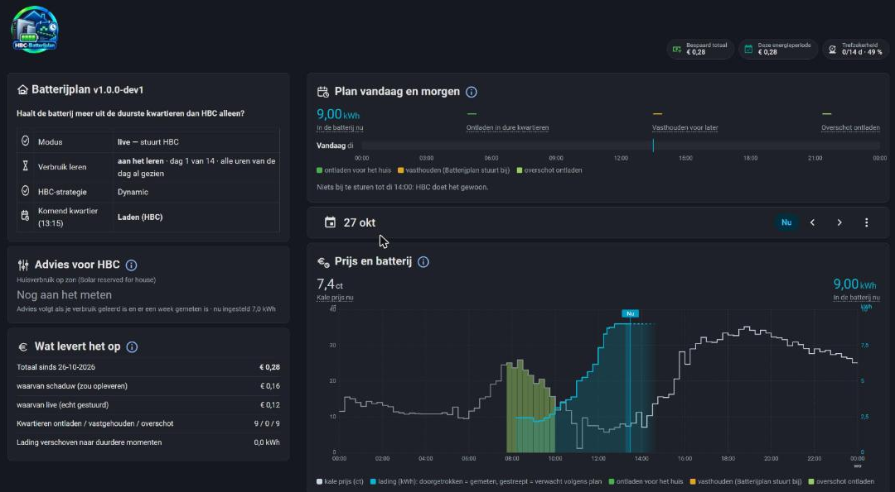

# 02 · Het dashboard

*English: [02-dashboard.md](02-dashboard.md) · Deutsch: [02-dashboard.de.md](02-dashboard.de.md)*

**In het kort**
- Links staat hoe Batterijplan ervoor staat, rechts het plan en de grafiek, onderaan de instellingen.
- Elke eigen kaart heeft een **(i)** naast de titel: klik erop voor uitleg. Ga met de muis over een cijfer met een stippellijn voor een korte toelichting.
- Kleuren zijn overal hetzelfde: **groen** = ontladen in een duur kwartier, **oranje** = vasthouden voor later, **lichtgroen** = overschot ontladen.

## Bovenaan: logo en badges

| Badge | Wat je ziet |
|---|---|
| **Bespaard totaal** | De geschatte opbrengst bovenop HBC sinds de start. |
| **Deze energieperiode** | Hetzelfde, maar vanaf de ingangsdatum van je contract. Elk contractjaar begint opnieuw. |
| **Trefzekerheid** | Hoe goed het geleerde verbruik het echte verbruik voorspelt. Tijdens de eerste 14 dagen grijs (licht → donker), daarna groen: hoe donkerder, hoe beter (donker groen boven 90 %). |

## Links

**Batterijplan (status)**

| Regel | Betekenis |
|---|---|
| Modus | **live** — stuurt HBC, of **schaduw** — rekent mee, stuurt niets. |
| Verbruik leren | "aan het leren · dag 3 van 14 · alle uren van de dag al gezien". Na 14 dagen: "klaar met leren · voorspelling 91 % raak". |
| HBC-strategie | Moet **Dynamic** zijn. Staat er iets anders, dan staat Batterijplan stil. |
| Komend kwartier | Wat Batterijplan voor het volgende kwartier besluit. |

**Advies voor HBC**

Eén regel over de HBC-instelling *Solar reserved for house* (hoeveel zonne-energie je huis zelf direct opmaakt):
- **Nog aan het meten** (grijs): het verbruik wordt nog geleerd of er is nog geen week gemeten.
- **Staat goed** (groen): je instelling ligt minder dan 1 kWh van wat er de laatste 7 dagen gemiddeld nodig was.
- **Aanpassen naar 5,5 kWh** (oranje): met eronder wat er nu is ingesteld en wat gemiddeld nodig was.

Is extra laden van het net vannacht zinvol, dan staat dat er ook bij. Batterijplan past HBC zelf nooit aan; jij beslist. Zie [03 · Hoe het werkt](03-how-it-works.nl.md#advies-voor-hbc).

**Wat levert het op**

| Regel | Betekenis |
|---|---|
| Totaal sinds … | De geschatte opbrengst bovenop HBC alleen. |
| waarvan schaduw | Wat het had opgeleverd terwijl *Live* uit stond. Dat geld heb je niet echt verdiend. |
| waarvan live | Wat het opleverde terwijl Batterijplan echt stuurde. |
| Kwartieren ontladen / vastgehouden / overschot | Hoe vaak Batterijplan elk van de drie dingen deed. |
| Lading verschoven naar duurdere momenten | Hoeveel kWh er door vasthouden later en duurder is gebruikt. |

## Rechts

**Plan vandaag en morgen**

- Bovenaan vier cijfers: **In de batterij nu**, hoe lang er **ontladen in dure kwartieren** wordt, hoe lang er **vastgehouden voor later** wordt, en hoeveel **overschot** er ontladen wordt.
- Per dag een balk van 00:00 tot 24:00. Alleen de momenten waarop Batterijplan iets anders doet dan HBC hebben een kleur; lege stukken betekenen: HBC doet het gewoon. De blauwe streep is nu.
- Daaronder de blokken in woorden, bijvoorbeeld "di 08:30–10:30 overschot ontladen · ± 0,65 kWh, ± € 0,10". Is er niets te doen: "Niets bij te sturen tot di 13:00: HBC doet het gewoon."
- De balk voor morgen verschijnt zodra HBC de prijzen van morgen heeft (meestal rond 13:00).

**De datumkiezer** (onder het plan)

Kies *Vandaag*, een andere dag, een week of een maand, en blader met ‹ ›. De grafiek eronder volgt de keuze.

**Prijs en batterij**

- **Per dag:** de grijze lijn is de kale stroomprijs per kwartier. De gekleurde vlakken zijn de kwartieren waarin Batterijplan bijstuurt. De blauwe lijn is de lading in kWh (as rechts): **doorgetrokken = gemeten**, **gestreept = verwacht volgens het plan**; na het einde van het plan dooft hij uit. Links van *Nu* is voorbij en iets gedempt.
- **Per week of maand:** een groene staaf per dag met wat Batterijplan geschat opleverde. Bovenaan het totaal, het gemiddelde per dag en de beste dag.
- Ga met de muis over de grafiek voor de prijs, wat de batterij deed en de lading in dat kwartier.

## Onderaan: Instellingen

Vijf tegels over de volle breedte:

| Tegel | Wat het doet |
|---|---|
| **Back-up maken** | Bewaart al je instellingen. |
| **Back-up terugzetten** | Zet de laatste back-up terug (met bevestiging). |
| **Standaardwaarden** | Zet veiligheidsmarge en rendement terug op 0,3 kWh en 75 %. Er wordt eerst een back-up gemaakt. |
| **Live** | Aan = Batterijplan stuurt HBC bij. Uit = schaduwmodus. |
| **Instellingen** | Aan = de invulvelden, de sensoren en de uitleg klappen open. Zolang er iets ontbreekt, blijven ze vanzelf staan. |

Onder de tegels staat wanneer de laatste back-up is gemaakt.
