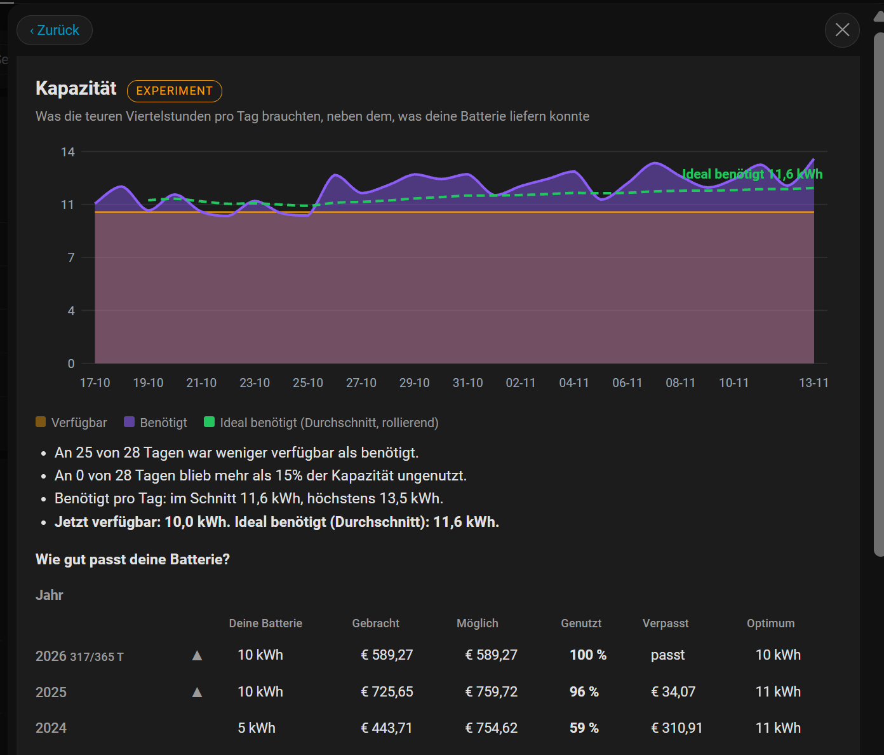

# 06 · Kapazitätsempfehlung (Experiment)

*English: [06-capacity.md](06-capacity.md) · Nederlands: [06-capacity.nl.md](06-capacity.nl.md)*

Das Bild ist mit Demodaten erstellt: eine Batterie mit 5 kWh in 2024, 10 kWh ab 2025.

## Welche Frage die Empfehlung beantwortet

War meine Batterie in letzter Zeit groß genug für die teuren Momente des Tages? Und wenn nicht: welche nutzbare Kapazität hätte besser gepasst, und wie viel mehr hätte das gebracht?

Die Empfehlung fällt kein Urteil. Sie rechnet keinen Batteriepreis und keine Amortisationszeit. Sie zeigt nur, was passiert ist, damit du selbst entscheiden kannst.

## Was jeden Tag gemessen wird

Jede Nacht, wenn ein Kalendertag vollständig ist (00:00 bis 24:00), schreibt Batterijplan einen Eintrag für diesen Tag.

1. **Die teuren Viertelstunden dieses Tages.** Sie werden so bestimmt, wie HBC es selbst tut, mit deinen eigenen HBC-Einstellungen:
   - die Anzahl günstiger und teurer Stunden, die du in HBC eingestellt hast;
   - der **minimale Preisunterschied**, den du in HBC eingestellt hast (zum Beispiel 6 Cent). Darin sind der Verlust beim Laden und Entladen und der Verschleiß bereits enthalten. Batterijplan fügt keine eigene Schwelle hinzu.
2. **Was die Batterie in diesen Viertelstunden hätte liefern müssen („benötigt“).** Pro teurer Viertelstunde ist das der Verbrauch deines Hauses minus die Sonne in diesem Moment (nie unter 0). Über alle teuren Viertelstunden des Tages addiert ergibt das die kWh, die die Batterie an diesem Tag benötigt hat.
3. **Was deine Batterie liefern konnte („verfügbar“).** Das ist die nutzbare Kapazität, die du in den Einstellungen eingetragen hast.
4. **Was der Plan bei anderen Kapazitäten gebracht hätte.** Der Tag wird mit denselben Preisen, demselben Verbrauch und derselben Sonne neu durchgerechnet, für jede nutzbare Kapazität von 3 bis 20 kWh. Pro Kapazität wird gespeichert, wie viel mehr der Plan bringt als HBC allein.
   - Was um 24:00 weniger in der Batterie ist als bei HBC allein, wird vom Ertrag abgezogen. Dieser Teil wird mit dem günstigsten Einkaufspreis des Tages bewertet. So zählt das Leeren der Batterie am Ende des Tages nicht als Gewinn.

## Wie die Empfehlung entsteht

- **Erst nach 7 Tagen** gibt es eine Empfehlung. Bis dahin steht nur da, wie viele Tage schon gemessen wurden.
- **Optimal** ist der **Durchschnitt** von „benötigt“ über die gemessenen Tage, auf ganze kWh aufgerundet. Es zählen höchstens die letzten 28 Tage. Ab 28 Tagen nennen wir die Empfehlung solide; davor ist sie eine erste Schätzung.
- **Tage mit zu wenig:** Tage, an denen benötigt mehr war als verfügbar.
- **Tage mit zu viel:** Tage, an denen mehr als 15 % deiner nutzbaren Kapazität ungenutzt blieb.
- **Zusätzliche Ersparnis:** der Ertrag bei der optimalen Kapazität minus der Ertrag bei deiner jetzigen Kapazität, addiert über die gemessenen Tage.

## Im Diagramm

- **Gelb (Vordergrund):** was deine Batterie liefern konnte.
- **Lila (Hintergrund):** was pro Tag benötigt wurde.
- **Grüne gestrichelte Linie:** der benötigte Durchschnitt, als gleitender Durchschnitt. Sie beginnt mit den ersten Tagen und wächst bis 28 Tage mit.

## Wie gut passt deine Batterie?

Unter dem Diagramm steht pro Zeitraum eine Zeile: Jahre (bis 5), Quartale und die Monate des laufenden Jahres, das neueste oben. Der Trend steht vorne.

| Spalte | Bedeutung |
|---|---|
| Deine Batterie | Die nutzbare Kapazität in diesem Zeitraum. Hast du sie geändert, siehst du beides, zum Beispiel 5 → 10 kWh. |
| Gebracht | Was der Plan mit deiner Batterie zusätzlich zu HBC allein gebracht hat. |
| Möglich | Was er mit der optimalen Kapazität dieses Zeitraums gebracht hätte. |
| Genutzt | Gebracht als Anteil von möglich. |
| Verpasst | Möglich minus gebracht. *Passt*, wenn nichts verpasst wurde. |
| Optimum | Die optimale Kapazität dieses Zeitraums. |

- Es werden nur echte Tagesbeträge addiert. Nichts wird auf einen ganzen Monat oder ein ganzes Jahr hochgerechnet. Bei einem laufenden Zeitraum steht, wie viele Tage er enthält, zum Beispiel 317/365 T.
- Das Optimum wird pro Zeitraum bestimmt. Ein Winter- und ein Sommerquartal können also ein anderes Optimum haben, und ein ganzes Jahr kann *passen*, während ein Winterquartal trotzdem etwas verpasst hat.
- Der Trend (▲, ▼ oder =) vergleicht den genutzten Anteil mit dem Zeitraum davor.
- Eine graue Zeile hat weniger als die Hälfte der Tage gemessen.

**Beispiel (Demodaten).** 2024 hatte die Batterie 5 kWh: 59 % genutzt, 311 € verpasst, Optimum 11 kWh. Ab 2025 hat die Batterie 10 kWh: 96 % genutzt und nur noch 34 € verpasst. So liest du aus der Tabelle ab, dass sich der Schritt von 5 auf 10 kWh gelohnt hat.

## Worauf du achten solltest

- **Es gilt für die Jahreszeit, in der du misst.** Im Winter, mit wenig Sonne, hilft eine größere Batterie meist mehr als im Sommer. Schau dir deshalb erst ein ganzes Jahr an, bevor du etwas kaufst.
- **Es ist eine Neuberechnung, keine Messung.** Der Ertrag bei anderen Kapazitäten ist das, was der Plan getan hätte. Das tatsächliche Verhalten von HBC und deiner Batterie kann etwas abweichen.
- **Die Ladeleistung zählt nicht.** Die Empfehlung betrifft nur kWh, nicht wie schnell die Batterie laden oder entladen kann.
- **Deine HBC-Einstellungen sind maßgeblich.** Änderst du in HBC den minimalen Preisunterschied oder die Anzahl günstiger und teurer Stunden, rechnet die Empfehlung ab dem nächsten Tag damit.

## Speichern und ein- oder ausschalten

- Die Tageseinträge bleiben **5 Jahre** gespeichert. Sie sind Teil des Home-Assistant-Backups und bleiben bei einem Update erhalten.
- Du schaltest das Experiment ein oder aus unter **Einstellungen → Experte → Experiment Kapazität**.
  - **Aus:** es werden keine neuen Tage gemessen und die Schaltfläche Kapazität verschwindet. Alles bereits Gemessene bleibt gespeichert.
  - **Wieder an:** die früher gemessenen Tage sind noch da. Tage, die du gerade verpasst hast, werden ergänzt, solange die Verbrauchsdaten dieser Tage noch verfügbar sind.
