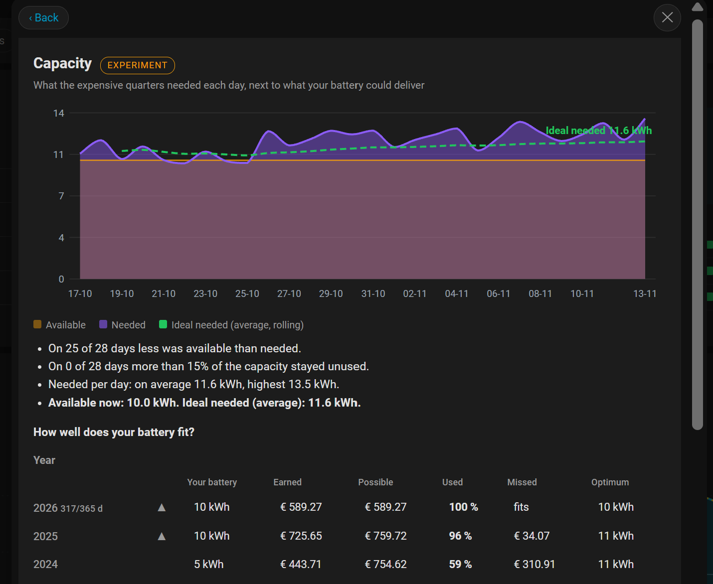

# 06 · Capacity advice (experiment)

*Nederlands: [06-capacity.nl.md](06-capacity.nl.md) · Deutsch: [06-capacity.de.md](06-capacity.de.md)*

The picture is made with demo data: a 5 kWh battery in 2024, 10 kWh from 2025.

## What the advice answers

Was my battery big enough for the expensive moments of the day lately? And if it was not: which usable capacity would have fitted better, and how much more would that have earned?

The advice makes no judgement. It uses no battery price and no payback time. It only shows what happened, so you can decide for yourself.

## What is measured each day

Every night, once a calendar day is complete (00:00 to 24:00), Batterijplan writes one record for that day.

1. **The expensive quarters of that day.** They are determined the way HBC does it, with your own HBC settings:
   - the number of cheap and expensive hours you set in HBC;
   - the **minimum price difference** you set in HBC (for example 6 cents). That already covers the loss when charging and discharging and the wear. Batterijplan adds no threshold of its own.
2. **What the battery should have delivered in those quarters ("needed").** For each expensive quarter this is your house use minus the sun at that moment (never below 0). Added up over all expensive quarters of the day, that is the number of kWh the battery needed that day.
3. **What your battery could deliver ("available").** This is the usable capacity you entered in the settings.
4. **What the plan would have earned at other capacities.** The day is recalculated with the same prices, the same use and the same sun, for every usable capacity from 3 to 20 kWh. For each capacity, how much more the plan earns than HBC alone is kept.
   - Whatever is left less in the battery at 24:00 than with HBC alone is subtracted from the earnings. That part is valued at the cheapest purchase price of that day. This way, emptying the battery at the end of the day does not count as a gain.

## How the advice is formed

- **Only after 7 days** is there an advice. Until then it only shows how many days have been measured.
- **Optimal** is the **average** of "needed" over the measured days, rounded up to whole kWh. At most the last 28 days count. From 28 days we call the advice solid; before that it is a first estimate.
- **Days with too little:** days on which needed was more than available.
- **Days with too much:** days on which more than 15 % of your usable capacity remained unused.
- **Extra savings:** the earnings at the optimal capacity minus the earnings at your current capacity, added up over the measured days.

## In the chart

- **Yellow (foreground):** what your battery could deliver.
- **Purple (background):** what was needed each day.
- **Green dashed line:** the average that was needed, as a rolling average. It starts with the first days and grows along up to 28 days.

## How well does your battery fit?

Below the chart there is one row per period: years (up to 5), quarters and the months of the running year, newest first. The trend comes first.

| Column | Meaning |
|---|---|
| Your battery | The usable capacity in that period. Did you change it, then you see both, for example 5 → 10 kWh. |
| Earned | What the plan earned on top of HBC alone with your battery. |
| Possible | What it would have earned with the optimal capacity of that period. |
| Used | Earned as a share of possible. |
| Missed | Possible minus earned. *Fits* when nothing was missed. |
| Optimum | The optimal capacity of that period. |

- Only real day amounts are added up. Nothing is extrapolated to a whole month or a whole year. A running period shows how many days are in it, for example 317/365 d.
- The optimum is determined per period. A winter quarter and a summer quarter can therefore have a different optimum, and a whole year can *fit* while a winter quarter still missed something.
- The trend (▲, ▼ or =) compares the share used with the period before.
- A grey row has fewer than half of its days measured.

**Example (demo data).** In 2024 the battery was 5 kWh: 59 % used, € 311 missed, optimum 11 kWh. From 2025 the battery is 10 kWh: 96 % used and only € 34 missed. That is how you read from the table that the step from 5 to 10 kWh paid off.

## What to keep in mind

- **It applies to the season in which you measure.** In winter, with little sun, a bigger battery usually helps more than in summer. So look at a whole year before you buy anything.
- **It is a recalculation, not a measurement.** The earnings at other capacities are what the plan would have done. The real behaviour of HBC and your battery can differ slightly.
- **Charge power does not count.** The advice is only about kWh, not about how fast the battery can charge or discharge.
- **Your HBC settings lead.** If you change the minimum price difference or the number of cheap and expensive hours in HBC, the advice uses them from the next day.

## Keeping data and switching on or off

- The day records are kept for **5 years**. They are part of the Home Assistant backup and stay in place on an update.
- You switch the experiment on or off in **Settings → Expert → Capacity experiment**.
  - **Off:** no new days are measured and the Capacity button disappears. Everything already measured is kept.
  - **On again:** the days measured earlier are still there. Days you just missed are filled in as long as the usage data of those days is still available.
