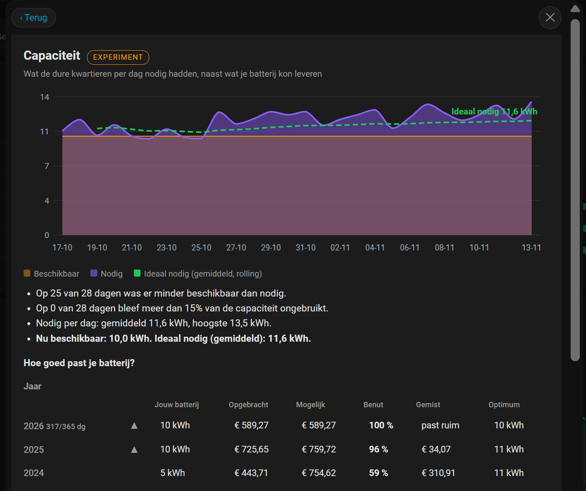

# 06 · Capaciteitsadvies (experiment)

*English: [06-capacity.md](06-capacity.md) · Deutsch: [06-capacity.de.md](06-capacity.de.md)*

Het plaatje is gemaakt met demogegevens: een batterij van 5 kWh in 2024, 10 kWh vanaf 2025.

## Waar het advies antwoord op geeft

Was mijn batterij de afgelopen tijd groot genoeg voor de dure momenten van de dag? En als dat niet zo was: welke bruikbare capaciteit had beter gepast, en wat had dat méér opgeleverd?

Het advies velt geen oordeel. Het rekent geen batterijprijs en geen terugverdientijd. Het laat alleen zien wat er gebeurd is, zodat je zelf kunt beslissen.

## Wat er elke dag wordt gemeten

Elke nacht, als een kalenderdag compleet is (00:00 tot 24:00), maakt Batterijplan één regel voor die dag.

1. **De dure kwartieren van die dag.** Die worden bepaald zoals HBC het zelf doet, met jouw eigen HBC-instellingen:
   - het aantal goedkope en dure uren dat je in HBC hebt ingesteld;
   - het **minimale prijsverschil** dat je in HBC hebt ingesteld (bijvoorbeeld 6 cent). Daarin zitten het verlies bij laden en ontladen en de slijtage al verrekend. Batterijplan voegt daar geen eigen drempel aan toe.
2. **Wat de batterij in die kwartieren had moeten leveren ("nodig").** Per duur kwartier is dat het verbruik van je huis min de zon op dat moment (nooit minder dan 0). Opgeteld over alle dure kwartieren van de dag geeft dat het aantal kWh dat de batterij die dag nodig had.
3. **Wat je batterij kon leveren ("beschikbaar").** Dat is de bruikbare capaciteit die je bij de instellingen hebt ingevuld.
4. **Wat het plan had opgeleverd bij andere capaciteiten.** De dag wordt opnieuw doorgerekend met dezelfde prijzen, hetzelfde verbruik en dezelfde zon, voor elke bruikbare capaciteit van 3 tot 20 kWh. Per capaciteit wordt bewaard wat het plan méér oplevert dan HBC alleen.
   - Wat er om 24:00 minder in de batterij zit dan bij HBC alleen, gaat van de opbrengst af. Dat deel wordt gewaardeerd tegen de goedkoopste inkoopprijs van die dag. Zo telt leegtrekken aan het eind van de dag niet als winst.

## Hoe het advies ontstaat

- **Pas na 7 dagen** komt er een advies. Tot dan staat er alleen hoeveel dagen er al gemeten zijn.
- **Optimaal** is het **gemiddelde** van "nodig" over de gemeten dagen, naar boven afgerond op hele kWh. Er telt maximaal de laatste 28 dagen mee. Vanaf 28 dagen noemen we het advies degelijk; daarvoor is het een eerste schatting.
- **Dagen met te weinig:** dagen waarop nodig meer was dan beschikbaar.
- **Dagen met te veel:** dagen waarop meer dan 15 % van je bruikbare capaciteit ongebruikt bleef.
- **Extra besparing:** de opbrengst bij de optimale capaciteit min de opbrengst bij je huidige capaciteit, opgeteld over de gemeten dagen.

## In de grafiek

- **Geel (voorgrond):** wat je batterij kon leveren.
- **Paars (achtergrond):** wat er per dag nodig was.
- **Groene stippellijn:** het gemiddelde dat nodig was, als lopend gemiddelde. Hij begint bij de eerste dagen en groeit mee tot 28 dagen.

## Hoe goed past je batterij?

Onder de grafiek staat per periode één regel: jaren (tot 5), kwartalen en de maanden van het lopende jaar, de nieuwste bovenaan. De trend staat vooraan.

| Kolom | Betekenis |
|---|---|
| Jouw batterij | De bruikbare capaciteit in die periode. Heb je hem veranderd, dan zie je beide, bijvoorbeeld 5 → 10 kWh. |
| Opgebracht | Wat het plan met jouw batterij bovenop HBC alleen opbracht. |
| Mogelijk | Wat het met de optimale capaciteit van die periode had opgebracht. |
| Benut | Opgebracht als deel van mogelijk. |
| Gemist | Mogelijk min opgebracht. *Past ruim* als er niets gemist is. |
| Optimum | De optimale capaciteit van die periode. |

- Alleen echte dagbedragen worden opgeteld. Er wordt niets doorgerekend naar een hele maand of een heel jaar. Bij een lopende periode staat hoeveel dagen erin zitten, bijvoorbeeld 317/365 dg.
- Het optimum wordt per periode bepaald. Een winter- en een zomerkwartaal kunnen dus een ander optimum hebben, en een heel jaar kan *ruim passen* terwijl een winterkwartaal toch iets miste.
- De trend (▲, ▼ of =) vergelijkt het benutte deel met de periode ervoor.
- Een grijze regel heeft minder dan de helft van de dagen gemeten.

**Voorbeeld (demogegevens).** In 2024 was de batterij 5 kWh: 59 % benut, € 311 gemist, optimum 11 kWh. Vanaf 2025 is de batterij 10 kWh: 96 % benut en nog maar € 34 gemist. Zo lees je uit de tabel af dat de stap van 5 naar 10 kWh de moeite waard was.

## Waar je op moet letten

- **Het geldt voor het seizoen waarin je meet.** In de winter, met weinig zon, helpt een grotere batterij meestal meer dan in de zomer. Kijk daarom pas naar een heel jaar voordat je iets koopt.
- **Het is een herberekening, geen meting.** De opbrengst bij andere capaciteiten is wat het plan had gedaan. Het werkelijke gedrag van HBC en van je batterij kan iets afwijken.
- **Laadvermogen telt niet mee.** Het advies gaat alleen over kWh, niet over hoe snel de batterij kan laden of ontladen.
- **Je HBC-instellingen zijn leidend.** Verander je in HBC het minimale prijsverschil of het aantal goedkope en dure uren, dan rekent het advies vanaf de volgende dag daarmee.

## Bewaren en aan- of uitzetten

- De regels per dag blijven **5 jaar** bewaard. Ze zitten in de back-up van Home Assistant en blijven staan bij een update.
- Je zet het experiment aan of uit in **Instellingen → Expert → Experiment capaciteit**.
  - **Uit:** er worden geen nieuwe dagen gemeten en de knop Capaciteit verdwijnt. Alles wat al gemeten is blijft bewaard.
  - **Weer aan:** de eerder gemeten dagen staan er nog. Dagen die je net gemist hebt, worden aangevuld zolang de verbruiksgegevens van die dagen nog beschikbaar zijn.
